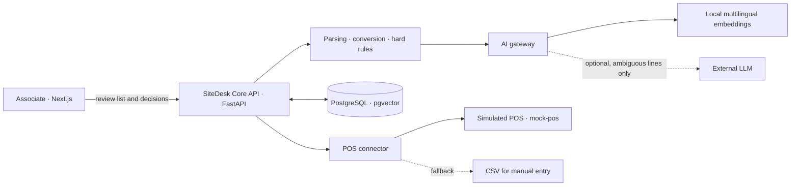

# SiteDesk

**Turn a customer's material list into a reviewable, stock-aware order at the counter.**

SiteDesk is a prototype built for the **IT Consultant Challenge 2026, Round 2**. It helps building-material retailers process lists that arrive as pasted text, PDF, spreadsheet, CSV, or customer email. The associate can review product matches, unit conversions, stock exceptions, and substitutions before confirming an order.

The project focuses on a practical integration problem: add a consistent workflow beside existing POS/ERP systems without pretending to replace them.

## What the prototype demonstrates

- **Two connected journeys:** handle a walk-in customer's list at the counter, or prepare an email quote and re-check price and stock when the customer returns.
- **Reviewable product matching:** local multilingual embeddings retrieve candidates; hard rules block incompatible or incomplete matches; associates resolve exceptions and customers approve substitutions.
- **Order-ready quantities:** convert requested units into sellable pack sizes and make rounding visible.
- **Resilient hand-off:** if matching is unavailable, use rule-based suggestions and manual catalog search; if the POS connector is unavailable, export a CSV with a reference for manual entry.
- **A measurable foundation:** record the challenge's time-to-serve, substitution-acceptance, and zero-touch indicators so a future pilot can assess them with real data.

## How it works



The LLM is optional and does not rank or select SKUs. It can extract attributes from ambiguous lines; values without evidence in the customer's text are discarded. Hard rules remain in control, and the associate confirms the final order. With no API key configured, the LLM stays disabled.

## Technology

| Layer | Technology |
| --- | --- |
| Web application | Next.js 14, React, TypeScript, Tailwind CSS |
| Core API | Python, FastAPI, Pydantic, SQLAlchemy |
| Catalog search | `multilingual-e5-small` embeddings and pgvector |
| Database | PostgreSQL 15 with pgvector |
| POS integration | FastAPI mock service representing a simulated POS/ERP |
| Local environment | Docker Compose |

## Run locally

**Requirements:** Docker Desktop (or Docker Engine with the Compose plugin).

```bash
git clone https://github.com/KhacToanNguyen-23/IT-Consultant-Challenge-2026.git
cd IT-Consultant-Challenge-2026
cp .env.example .env
docker compose up --build
```

In PowerShell, use `Copy-Item .env.example .env` instead of `cp`.

Open the application at **[http://localhost:3001](http://localhost:3001)**. The API documentation is at [http://localhost:8000/docs](http://localhost:8000/docs), and the simulated POS API is at [http://localhost:8001/docs](http://localhost:8001/docs).

On first startup, the local embedding model is downloaded and cached in a Docker volume. This is roughly 0.5 GB. The app can run without an external LLM key; configure one only in your local `.env` if you want to exercise the optional extraction path. Never commit `.env` or API keys.

## Project documents

- [MVP System Requirements Specification (PDF)](docs/SiteDesk_MVP_SRS.pdf) · [Markdown source](docs/SiteDesk_MVP_SRS.md)
- [User Journey (PDF)](<docs/diagrams/User Journey.pdf>)
- [System Diagram (PDF)](<docs/diagrams/System Diagram.pdf>)
- [Demo cases and walkthrough](docs/demo-case-sheet.md)
- [Contribution workflow](CONTRIBUTING.md)

The demo catalog contains 62 seeded products. POS, prices, and inventory are simulated; no stock is reserved and SiteDesk does not send email. Email and phone numbers are masked before AI processing, but this prototype does not guarantee removal of every personal detail. It has not been validated against live POS/ERP systems or production catalogs.

## Repository layout

```text
backend/       FastAPI API, matching pipeline, AI gateway, persistence, tests
frontend/      Next.js associate interface and quote journeys
mock-pos/      Simulated POS/ERP API and deterministic demo catalog
docs/          Requirements, demo walkthroughs, architecture and evaluation notes
docker-compose.yml
```
