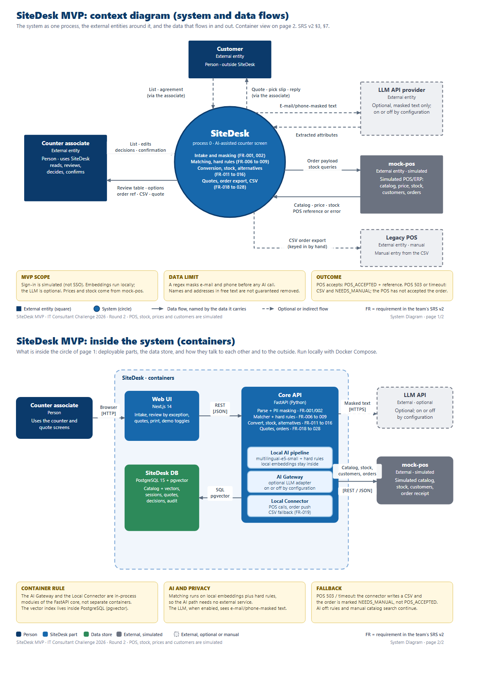
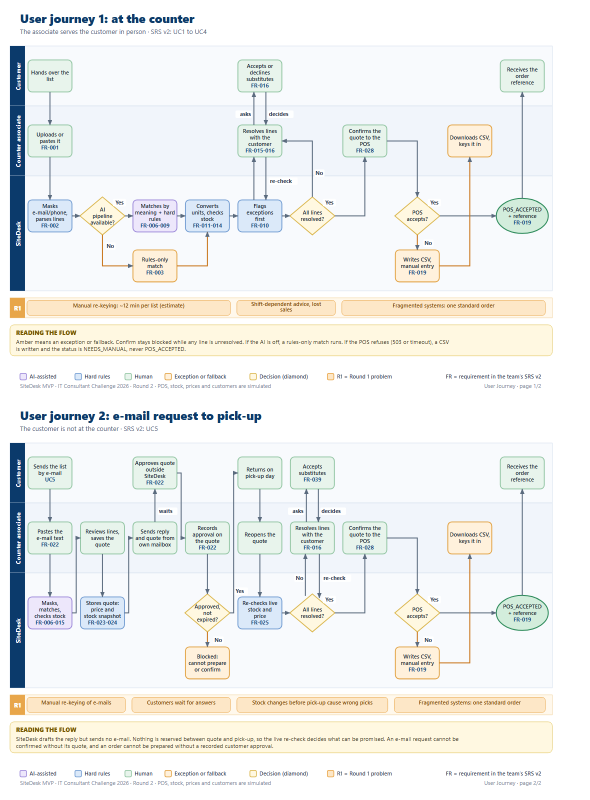

# SiteDesk

**From a contractor’s material list to an order a counter associate can stand behind.**

SiteDesk is our response to the **IT Consultant Challenge 2026**. It starts with a familiar moment at a building-materials counter: a customer hands over a long list, while the associate has to interpret product descriptions, check quantities and availability, and re-enter the order across fragmented store systems.

Our focus is the decision at the counter. SiteDesk helps the associate move the list forward, makes uncertain lines visible, and leaves the final choice with the people serving the customer.

## Round 1 — The problem we chose

The case described a Danish construction retailer operating across Denmark, Norway, and Sweden. Local systems and ways of working had grown apart. At the store counter, staff manually searched and re-keyed material lists, while stock-out advice could vary by associate. The resulting delays and order errors affected both customer experience and fulfilment.

Our Round 1 proposal focused on the counter as the point where those problems meet. It set three goals for a future rollout:

| Round 1 goal | Proposed target |
| --- | ---: |
| Time to serve a material list | About 12 minutes to under 2 minutes |
| Out-of-stock lines saved through an accepted alternative | At least 30% |
| Lines matched with no edits at a score above 90% | At least 70% |

The 12-minute figure is the baseline measured in Round 1 discovery; the under-2-minute figure and the other percentages are proposal targets. None is a result proven by this MVP or by a live-store pilot.

## Round 2 — What the challenge asked us to prove

Round 2 moved the work from proposal to demonstration. The MVP had to show its core functionality, its main user journeys, and the value it could bring. If the product had changed since Round 1, the team had to explain what changed and why. The work was assessed on reliable functionality, a reasonable system design, appropriate AI use with human validation, and clear reasoning tied to the original problem.

The submission package called for four items: an MVP demo video, a user journey, a system context diagram, and an AI Journal. The sections below show how SiteDesk responds to that brief and link to the project materials available here.

## How SiteDesk answers Round 2

### 1. A counter list becomes a reviewable order

An associate brings in a customer’s list from a PDF or pasted text. SiteDesk turns it into order lines, suggests catalog matches, converts requested quantities into sellable units, and brings uncertain, unavailable, or rounded lines forward for review. The associate can resolve a line, ask the customer about an alternative, and confirm the order.

If the simulated POS is unavailable, the order can be handed off as a CSV for manual entry. The workflow is designed to keep the counter moving when an integration fails.

### 2. An email request becomes a quote, then an approved order

The associate can also paste a customer email and prepare a quote. The customer’s approval is recorded before the order is confirmed. When the customer returns, SiteDesk checks the simulated price and stock again, so the associate can resolve changes before completing the hand-off.

This second journey addresses a different part of the same problem: a quote is useful only if the store can revisit it and confirm what is actually available.

### 3. AI assists; people decide

Product suggestions are treated as suggestions, not decisions. Required product attributes must satisfy hard constraints; an unclear or unsafe match stays visible for review. Associates choose how to resolve exceptions, and customers must accept proposed substitutes. Every order still needs a human confirmation.

### 4. Value is measured without overstating the result

The MVP records the three measures carried forward from Round 1: time to serve, accepted substitutions, and zero-touch matching. In this demo they provide evidence that the workflow can be measured. They do **not** establish that the Round 1 targets have been met in a real store.

### What changed from Round 1

Round 1 described a wider, multi-market business case. For Round 2, we narrowed that ambition to two demonstrable journeys: the in-store counter order and the email-to-quote journey. Store data and the POS hand-off are simulated, and a quote does not reserve stock. That scope let us demonstrate the decisions and failure paths that matter at the counter without presenting a prototype as a production deployment.

## The system behind the story

The diagram shows how the associate, customer, SiteDesk, and simulated store services interact. It is here to explain the boundaries of the MVP—not to make the technology stack the story.

The two journeys are shown together below.

## Project and submission materials

| Material | What it contains |
| --- | --- |
| [User Journey (PDF)](<docs/diagrams/User Journey.pdf>) | The counter-order and email-quote journeys, including decision points and MVP boundaries. |
| [System Diagram (PDF)](<docs/diagrams/System Diagram.pdf>) | System context and architecture for the interactions demonstrated in the MVP. |
| [MVP System Requirements Specification (PDF)](docs/SiteDesk_MVP_SRS.pdf) · [Markdown source](docs/SiteDesk_MVP_SRS.md) | The scope and behavior used to guide the Round 2 implementation. |
| [Demo case sheet](docs/demo-case-sheet.md) | The sample scenarios used to walk through the product and its failure paths. |
| [AI Journal source (DOCX)](<docs/ai-journal/AI Journal.docx>) | The editable journal source; the challenge submission requested a PDF. |

## Prototype boundaries

This is a competition MVP, not a live store deployment. Catalog, customer, price, stock, and POS behavior are simulated. SiteDesk drafts email replies but does not send email, and quotes do not reserve stock. The demo is not a validation of production accuracy, live POS/ERP integration, or the Round 1 business targets.
