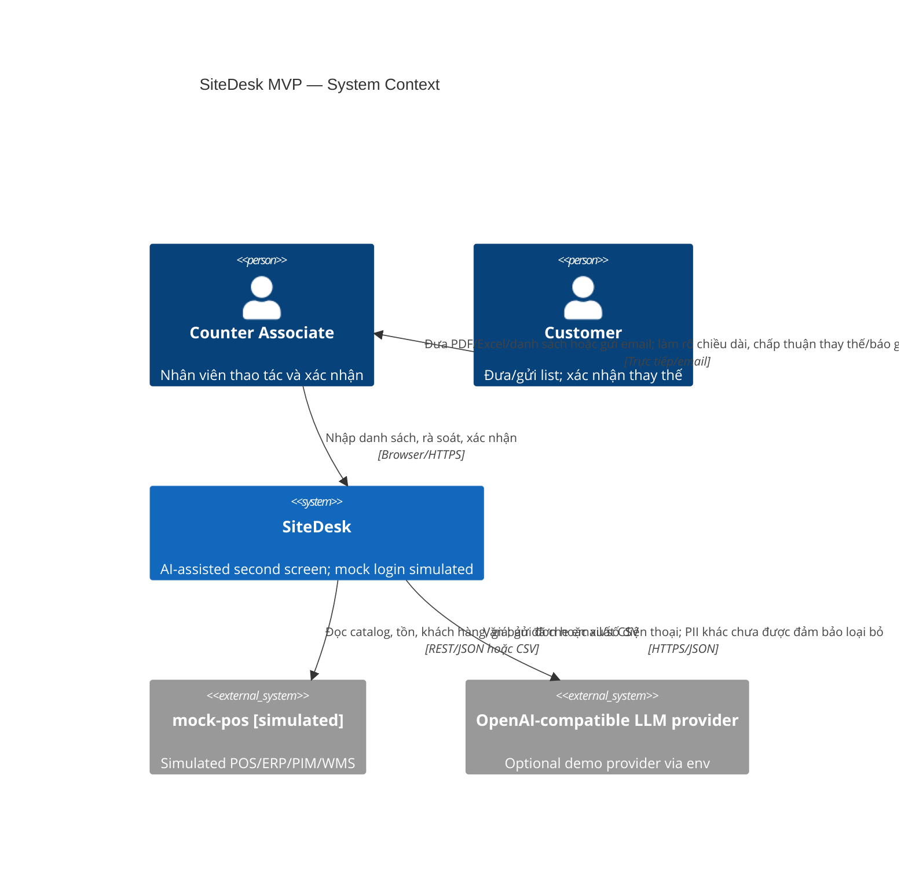
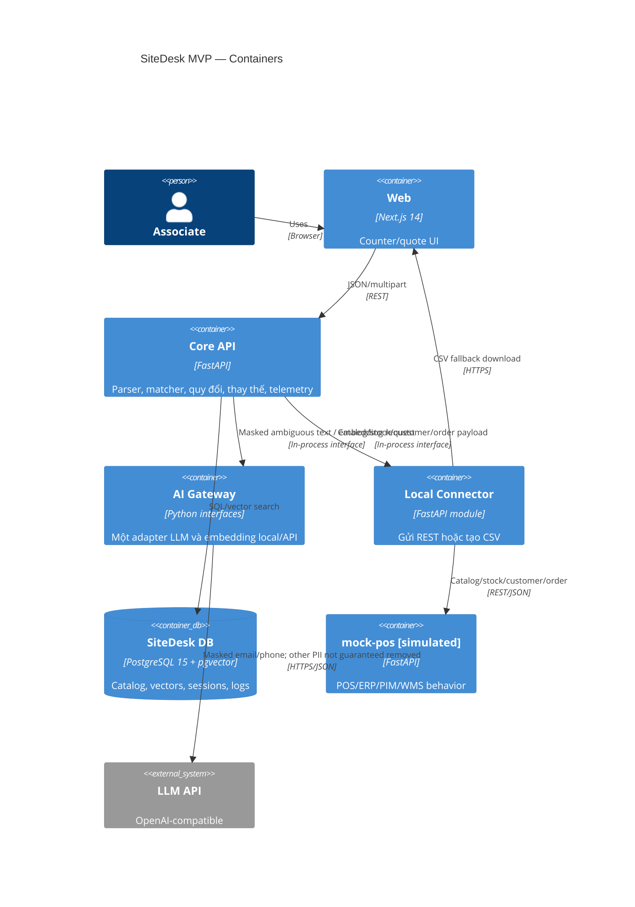
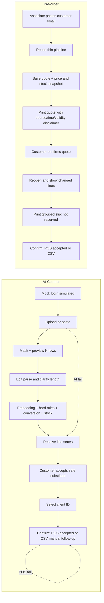
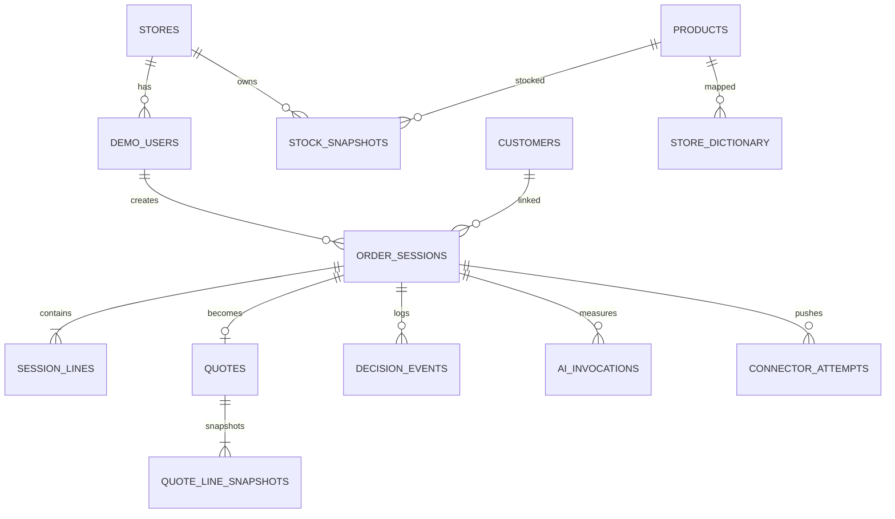

# SiteDesk — Software Requirements Specification cho MVP Round 2

**Phiên bản:** 2.0 · **Ngày cập nhật:** 04/11/2026 · **Hạn nộp:** 22:00 GMT+7, 09/11/2026  
**Trạng thái:** Scope-cut implementation baseline · **Thị trường demo:** DK / DKK

> Các số 12 phút, `<2 phút`, `≥30%`, `≥70%` là mục tiêu/giả định Round 1, chưa phải kết quả đo. MVP chạy local; POS/ERP/SSO/catalog/stock/price đều **simulated**. Không ghi secret vào repo hoặc tài liệu.

---

## 0. Đọc trước (cho cả đội)

### 0.1 Bối cảnh và đánh giá cơ hội

Cuộc thi dành cho sinh viên và người mới đi làm. Chủ đề “Prompt to Production” cho phép dùng AI, nhưng đội phải kiểm chứng và chịu trách nhiệm về kết quả; FAQ cũng khuyến cáo không dùng tài liệu được tạo hoàn toàn bằng AI. Vòng 1 có 160 đội và 21 đội vào Vòng 2. Vòng 2 diễn ra trực tuyến từ 02/11 đến 09/11/2026, hạn nộp là 22:00 (GMT+7) ngày 09/11; kết quả công bố ngày 16/11. Vòng 3 là Pitching từ 16/11 đến 21/11, chung kết ngày 21/11. Trang chính thức không công bố số đội đi tiếp hoặc thang điểm. Cơ cấu giải và học bổng Top 5, Top 10, Top 20 chỉ gợi ý rằng bảng xếp hạng cuối có thể có từ 5 đến 10 đội trở lên; đây là suy luận, không phải thông tin chính thức.

Đội có một Software Engineer và một AI Engineer cùng viết mã, chủ yếu bằng vibe coding với hai tài khoản Claude Pro và một Codex Plus; thành viên Hệ thống thông tin/Business Analyst phụ trách diagram, AI Journal và video. Đội có sẵn server và domain, nhưng deploy không phải điều kiện nộp. Kế hoạch thực thi bắt đầu từ 04/11 vì ngày 03/11 đã kết thúc.

Các tỷ lệ dưới đây là **ước lượng chủ quan của trợ lý AI, không phải số liệu chính thức hoặc dự báo của ban tổ chức**:

| Số đội giả định đi tiếp | Khả năng ước lượng của đội |
|---|---:|
| Top 5 | khoảng 25–30% |
| Top 8 | khoảng 40–45% |
| Top 10 | khoảng 50–55% |

Nếu buộc phải chọn một con số, ước lượng trung tâm là khoảng **40%**, với biên dao động khoảng ±15 điểm phần trăm. Cách ước lượng dùng ba kịch bản thực thi: hoàn thành Luồng 1 từ đầu đến cuối, demo mượt và bốn file nhất quán, khoảng 55%; sản phẩm chạy nhưng còn vấp hoặc tài liệu làm vội, khoảng 35%; không hoàn thành luồng chính, khoảng 10%. Nhóm làm tốt trong 21 đội được ước chừng là 8–9 đội. Ước lượng này bị giới hạn vì không biết số đội đi tiếp, thang điểm và bài làm của 20 đội còn lại.

Mức hoàn thành ước lượng của phạm vi SRS v1 gồm 35 yêu cầu là khoảng **30%**. Sau khi gọt sang v2, mức hoàn thành ước lượng là khoảng **60–65%** nếu Luồng 1 được làm trọn vẹn. Phần diagram, AI Journal và video do thành viên Hệ thống thông tin phụ trách được ước lượng khoảng **90%**. Các con số này cũng chỉ là ước lượng của trợ lý AI, chưa được đo bằng bằng chứng triển khai. Ý tưởng và kế hoạch không phải điểm yếu vì đội đã qua Vòng 1, nhưng ở Vòng 2 sản phẩm chạy được mới tạo khác biệt. ROI trong Round 1 là giả định và không phải tiêu chí chấm Round 2.

Rủi ro lớn nhất là không hoàn thành luồng chính trong khoảng năm ngày; hai người viết mã không tự xử lý được khi trợ lý AI kẹt; ghép mã vào phút chót; và hai người viết mã không giải thích được kiến trúc cùng pipeline khớp SKU khi bước vào Vòng 3.

### 0.2 Ba thông điệp phải thể hiện trong video

1. **“AI không được phép sai một cách im lặng.”** Video cần cho thấy dòng 45x95 C18 không được coi như C24, bị đưa về trạng thái cần làm rõ và có lý do. Chỉ gọi kết quả bộ test là “kết quả ban đầu” nếu bộ test có dưới 150 dòng.
2. **“Quầy không bao giờ bị dừng.”** Khi AI lỗi, nhân viên vẫn tìm SKU thủ công và xác nhận đơn; khi POS lỗi, hệ thống tự xuất CSV.
3. **“Từ danh sách thô đến đơn xác nhận, có thời gian đo thật.”** Demo 20 dòng với mục tiêu phân tích khoảng 3 giây và chỉ nêu số đo lấy từ log thực tế.

Video mở bằng thông điệp: “Chúng tôi giữ hai hành trình và giá trị cốt lõi của proposal; một số tích hợp và yêu cầu vận hành được mô phỏng hoặc triển khai ở mức tối thiểu.” Video kết bằng giới hạn cùng bước tiếp theo. Phần khớp SKU phải thật sự dùng embedding kết hợp quy tắc cứng, không chỉ so chuỗi. Không đầu tư thêm vào cache, trần ngân sách, dashboard KPI, đăng nhập chi tiết hoặc tối ưu tải mô hình vì các phần này không tạo giá trị trực tiếp trong video.

### 0.3 Mốc cứng và quy tắc cắt

- Hết 05/11, Luồng 1 phải chạy từ upload đến bảng kết quả với dữ liệu seed cố định. Nếu chưa đạt, cắt theo thứ tự sau, dừng ngay khi đủ thời gian cho phần còn lại:
  1. Luồng 2 / Pre-order (MVP-FR-022–028): dừng ở mức SRS, không code; video chỉ mô tả bằng slide.
  2. Mock login/SSO (MVP-FR-032): dùng một user cứng, bỏ chọn store/role nếu có.
  3. Telemetry/stage timing chi tiết (MVP-FR-029–031): giữ log tối thiểu đủ cho KPI thời gian ở §0.2-3, bỏ breakdown theo stage.
  4. Alias boost/store_dictionary (một phần MVP-FR-007, đã ghi "tùy chọn"): bỏ, chỉ dùng embedding + hard constraint. Nguồn highlight (MVP-FR-004) cắt sau cùng vì ít ảnh hưởng demo.
  Luồng 1 At-Counter, hai fail mode (AI/POS) và bộ test khớp SKU không được cắt; đây là phần video và giám khảo thấy trực tiếp.
- Ngày 08/11 khóa code; sau đó chỉ sửa lỗi.
- Chạy kịch bản demo mỗi ngày trên cùng dữ liệu seed và tạo tag `demo-ok-N` mỗi khi bản demo chạy tốt.
- Nộp trước 22:00 ngày 09/11/2026 tới `EB.VN@netcompany.com`, tiêu đề `Round 2 – <Tên đội>`.

### 0.4 Phạm vi v2 tóm tắt

| Trạng thái | Số yêu cầu | Ý nghĩa |
|---|---:|---|
| KEEP | 18 | Gồm 13 yêu cầu của v1 (kể cả hai fail toggle ở FR-033) và 5 yêu cầu BA mới có tiêu chí nghiệm thu riêng. |
| THIN | 22 | Làm lát cắt mỏng đúng mô tả ở §4; ưu tiên bằng chứng nhìn thấy trong demo. |
| DEFER | 0 | Brief v2 không gán ID MVP-FR nào vào DEFER; các giới hạn không có ID được liệt kê ở §14. |

### Thay đổi so với v1

- Giữ nguyên 35 ID yêu cầu, thêm trạng thái KEEP/THIN và làm mỏng Luồng 2, đăng nhập, telemetry, seed cùng các tiện ích phụ.
- Bỏ LLM rerank; pipeline chính là quy tắc, embedding và ràng buộc cứng.
- Bổ sung trạng thái dòng, trạng thái đơn, câu chữ tồn kho/báo giá và việc khách chấp thuận thay thế.
- Chuyển kế hoạch sang 04/11–09/11, thêm quy trình dùng AI, deploy tùy chọn và Diagram Brief cho thành viên Hệ thống thông tin.

---

## 1. Mục đích, phạm vi, định nghĩa và truy vết Round 1

### 1.1 Mục đích và phạm vi

SiteDesk là web “second screen” cho nhân viên quầy Company A: nhận PDF, Excel/CSV hoặc text/email; che PII; bóc tách; khớp SKU; quy đổi selling unit; đọc tồn; đề xuất thay thế; nhân viên duyệt; đẩy payload qua Local Connector hoặc CSV fallback.

Hai luồng: **At-Counter** (UC1 → UC4 → UC2 → UC3) và **Pre-order / Advance Quote** (UC5). UC5 chỉ nhận email do nhân viên dán, không có khách tự đặt “online”. Phạm vi giữ UC1–UC5, FR-01–07, NFR-01–07, payload slide 9, ba KPI slide 10, Core & Connector. Ngoài phạm vi: §14.

### 1.2 Thuật ngữ

| Thuật ngữ | Nghĩa |
|---|---|
| Match score | Điểm xếp hạng `[0,1]`, không phải xác suất. |
| Zero-touch | Score `>0.90` và dòng không có event `PARSE_EDITED`, `SKU_EDITED`, `SUBSTITUTION_ACCEPTED` hoặc `SUBSTITUTION_REJECTED`. Dòng đúng `0.90` không thuộc nhóm zero-touch. Mẫu số loại dòng `UNREADABLE` và dòng bị xóa khỏi đơn; dòng nhân viên thêm tay không được tính zero-touch. Mọi hành động chỉnh tay phải ghi đúng event này — `associate_edited` chỉ là cache suy ra từ event, không phải nguồn sự thật. |
| On-hand | Tồn tổng cửa hàng, không phải ATP, không có vị trí kệ. |
| Must-match | Thuộc tính kỹ thuật không được lệch theo nhóm hàng. |
| Core | Frontend, Backend, PostgreSQL/pgvector dùng chung. |
| Local Connector | Adapter API/CSV theo thị trường; MVP gọi `mock-pos`. |
| PII | Email, điện thoại, tên, địa chỉ; `client_id` là pseudonymous. |
| Quote snapshot | Giá/tồn lúc lưu; không giữ chỗ. |

### 1.3 Nguồn và ưu tiên

1. `SiteDesk_SRS_10_Slides_EN.pptx` (cam kết đã nộp).
2. `SiteDesk_SRS.md` khi slide không nêu.
3. Đề Round 2 PDF.
4. `SiteDesk_Flow_Review.md`, nhưng D01–D25 thắng.
5. Scaffold hiện tại.

### 1.4 Truy vết Round 1 → MVP

| Round 1 | Requirement MVP |
|---|---|
| UC1 | MVP-FR-001..010 |
| UC2 | MVP-FR-014..016, 039 |
| UC3 | MVP-FR-010, 017..020, 036..037 |
| UC4 | MVP-FR-006..013, 021 |
| UC5 | MVP-FR-022..028, 038, 040 |
| FR-01 | MVP-FR-001..005 |
| FR-02 | MVP-FR-006..010 |
| FR-03 | MVP-FR-011..013 |
| FR-04 | MVP-FR-014..016, 039 |
| FR-05 | MVP-FR-017..020, 037 |
| FR-06 | MVP-FR-022..028, 038, 040 |
| FR-07 | MVP-FR-021, 029..031 |
| NFR-01 | MVP-NFR-001 |
| NFR-02 | MVP-FR-002, 032; MVP-NFR-002 |
| NFR-03 | MVP-NFR-003 |
| NFR-04 | MVP-FR-010, 036; MVP-NFR-004 |
| NFR-05 | MVP-NFR-005 |
| NFR-06 | MVP-FR-003, 019, 033; MVP-NFR-006 |
| NFR-07 | MVP-FR-034; MVP-NFR-007 |

### 1.5 Changes since Round 1

- “Confidence” hiện thực thành **match score**, hard constraints, ba dải và evaluation.
- Phạm vi masking MVP được giới hạn rõ: regex che email và số điện thoại trước khi gửi AI; tên, địa chỉ và PII khác trong văn bản tự do chưa được đảm bảo che. Không gọi đây là “Zero PII”. `client_id` là pseudonymous; source đã qua bước masking hiện có được giữ đến Confirm/quote expiry; log phi PII giữ lâu dài.
- EU/EEA là production target. Demo dùng provider theo env, không claim sovereign khi chưa xác minh. DeepSeek official API không dùng cho tuyên bố sovereign; production hướng self-host open-weights tại EU/EEA.
- PostgreSQL 15 + pgvector; embedding local; `mock-pos` riêng là chi tiết triển khai Core & Connector.
- “30-second review” là phần ngoại lệ; toàn bảng vẫn hiện. Partial stock như stockout. Quote không giữ chỗ.
- SSO/POS/ERP/catalog/stock/price của MVP là simulated; giới hạn ở §14.

---

## 2. Kiến trúc và luồng dữ liệu

### 2.1 Containers

| Container | Công nghệ/cổng | Trách nhiệm |
|---|---|---|
| Web | Next.js 14/TypeScript/Tailwind, `:3001` | Login mock, intake, review, quote/print |
| Core API | FastAPI, `:8000` | Parser, PII, AI Gateway, matching, conversion, alternatives, connector, telemetry |
| DB | PostgreSQL 15 + pgvector, `:5432` | Catalog/vector/session/quote/dictionary/audit |
| mock-pos | FastAPI, giả định `:8001` | **Simulated** POS/ERP/PIM/WMS, price/order, `FAIL_MODE` |
| LLM | OpenAI-compatible, env | Chỉ parse khó và extract thuộc tính mơ hồ; nhận văn bản đã mask email/điện thoại, PII khác chưa được đảm bảo loại bỏ; không rerank |

Embedding dự kiến dùng `intfloat/multilingual-e5-small`: đa ngôn ngữ, 384 chiều, nhỏ hơn `bge-m3`, phù hợp thử nghiệm CPU. **Giả định cần benchmark:** weights khoảng 0.5 GB, batch 20 dòng ≤0.8 s. Nếu việc cài model và dựng Docker tốn quá nửa ngày, AI Engineer quyết định trước 12:00 ngày 04/11 chuyển `EMBEDDING_PROVIDER=api` thành mặc định và giữ local embedding cho giai đoạn sau. Đổi model phải chạy `scripts/reindex_catalog.py`; v2 bỏ kiểm tra số chiều fail-fast.

### 2.2 C4 Level 1 — Mermaid



### 2.3 C4 Level 2 — Mermaid



### 2.4 Sequence Analyze/Confirm

```mermaid
sequenceDiagram
actor A as Associate
participant W as Web
participant C as Core API
participant D as PostgreSQL+pgvector
participant L as LLM (conditional)
participant P as mock-pos (simulated)
A->>W: Upload/paste
W->>C: POST analyze
C->>C: extract → mask → rules; assign line states
opt ambiguous and AI available
C->>L: masked text + schema
L-->>C: JSON
end
C->>D: vector top-10 + optional store dictionary
C->>C: hard rules → score → conversion; no LLM rerank
C->>P: GET stock
C->>D: persist lines/telemetry
C-->>W: preview/candidates/stock
A->>W: resolve NEEDS_CLARIFICATION; customer accepts substitution; Confirm
W->>C: POST confirm (Idempotency-Key)
C->>D: validate/lock
C->>P: POST /orders
alt success
P-->>C: pos_order_ref
C->>D: POS_ACCEPTED; dictionary; purge source
else 503/timeout
C->>C: generate CSV
C->>D: NEEDS_MANUAL + CSV ref; dictionary; purge source
end
C-->>W: immutable status/ref/download
```

### 2.5 User Journey — hai luồng



AI Gateway có `LLMProvider`, `EmbeddingProvider`. Connector có `CONNECTOR_MODE=api|csv`; API fail luôn phát CSV.

---

## 3. Actors, hai luồng và nhánh lỗi

### 3.1 Actors

| Actor | Quyền/trách nhiệm |
|---|---|
| Associate | Login mock; tạo/sửa/duyệt; quote; Confirm; gỡ store mapping. |
| Customer | Ngoài hệ thống; đưa list, quyết định thay thế. |
| mock-pos | External simulated source/receiver. |
| LLM provider | External optional processor; receives email/phone-masked text, with other PII removal not guaranteed. |

### 3.2 At-Counter

1. Login mock; resume draft server-side của user/store.
2. Upload PDF/XLSX/CSV hoặc paste; hiện source sau regex masking email/điện thoại, “Đã đọc N dòng”, kể cả unreadable. Không tuyên bố đã loại bỏ tên/địa chỉ/PII khác.
3. Sửa `item_text`, `requested_qty`, `requested_unit`; Analyze.
4. Khớp/quy đổi/tồn; exceptions trước nhưng đủ dòng.
5. Partial/out: xem ≤2 alternatives; chọn hoặc ghi lý do.
6. Resolve mọi dòng `<.80`; chọn client hoặc `<STORE>-WALKIN`.
7. Confirm idempotent, read-only; API fail → CSV. AI fail → rules/full-text search vẫn Confirm.

Trạng thái xử lý chính của dòng dùng một cơ chế duy nhất: `NEEDS_CLARIFICATION → MATCHED → UNIT_CONVERTED → SUBSTITUTE_PROPOSED → CUSTOMER_ACCEPTED`. Các thuộc tính có thể đồng thời đúng như `rounded`, `stock_status` và `substitution_status` được lưu riêng, không ghi đè trạng thái xử lý chính. Confirm bị chặn nếu còn `NEEDS_CLARIFICATION`, thiếu dữ liệu bắt buộc để quy đổi, hoặc còn thay thế chưa được khách chấp thuận. Màu vàng/đỏ là cách hiển thị, không phải state machine thứ hai.

Trạng thái đơn: `CONFIRMED → SENT_OR_EXPORTED → POS_ACCEPTED` hoặc `NEEDS_MANUAL`. `PUSHED` cũ ánh xạ sang `POS_ACCEPTED`; `CSV_FALLBACK` cũ ánh xạ sang `SENT_OR_EXPORTED` kèm `NEEDS_MANUAL`. Mã tham chiếu chống nhập trùng đi cùng đơn và file CSV.

### 3.3 Pre-order / Advance Quote

Paste email → clean/mask email/phone → pipeline At-Counter → lưu `BG-<COUNTRY>-<4 digits>` + client/validity/price-stock snapshot → print quote → khách xác nhận quote ngoài SiteDesk và nhân viên ghi nhận xác nhận → Prepare recheck/diff/alternatives → print slip nhóm category với **“chưa giữ chỗ trên hệ thống”** → reopen → Confirm. Expiry tính khi read/write, không scheduler. MVP chỉ được chuyển sang Prepare khi có `customer_confirmed_at` và `customer_confirmed_by`.

State: `SAVED → SENT → PREPARING → CONFIRMED | EXPIRED | CANCELLED`, có actor/time trong cùng bản ghi quote; v2 bỏ bảng lịch sử append-only. `CONFIRMED` nghĩa là đơn đã được gửi hoặc xuất qua connector, không chứng minh bàn giao cho khách. Không dùng `COLLECTED` trong MVP vì không có thao tác xác nhận nhận hàng. Không versioning, reservation, warehouse UI, scheduler/badge.

### 3.4 Nhánh lỗi chung

| Lỗi | Hành vi |
|---|---|
| AI fail / `AI_FAIL_MODE=true` | Banner; rules text/XLSX/CSV, PDF text extraction, full-text search; Confirm được. |
| POS 503/timeout | CSV tự động, `SENT_OR_EXPORTED` + `NEEDS_MANUAL`, retry/download giữ cùng reference. Trước khi coi là cần nhập tay, hệ thống retry `POST /orders` với cùng idempotency key: nếu POS đã nhận đơn trước khi timeout, trả về replay 200 và chuyển `POS_ACCEPTED`, tránh nhập trùng; chỉ còn `NEEDS_MANUAL` nếu retry cũng fail. |
| Scan-only/unsupported | 422, hướng dẫn paste/gõ; không OCR. |
| Unknown unit/missing attr | Vàng; không đoán/convert; phải resolve. |
| DB unavailable | 503; không báo lưu/Confirm thành công. |

---

## 4. Yêu cầu chức năng chi tiết

| ID | Yêu cầu | Ưu tiên | Trạng thái v2 | Trace | Tiêu chí chấp nhận kiểm chứng được |
|---|---|---:|---|---|---|
| MVP-FR-001 | Nhận PDF text/XLSX/CSV/text/email; session server-side. | P0 | KEEP | UC1, FR-01 | Fixture hợp lệ trả session/masked preview/rows; scan-only 422. |
| MVP-FR-002 | Che email và điện thoại bằng regex trước AI. Tên, địa chỉ và PII khác trong văn bản tự do chưa được đảm bảo phát hiện/che trong MVP. | P0 | THIN | UC1, FR-01, NFR-02 | Provider spy không nhận email/phone trong fixture; kiểm thử xác nhận giới hạn masking được ghi rõ trong UI/tài liệu. |
| MVP-FR-003 | AI lỗi vẫn parse text/XLSX/CSV bằng quy tắc và tìm SKU full-text. | P0 | THIN | UC1, NFR-06 | Fail mode hiện banner, tạo rows, cho chọn SKU và Confirm. |
| MVP-FR-004 | Hiện “Đã đọc N dòng” và cho sửa name/qty/unit; source highlight là tùy chọn nếu còn thời gian. | P1 | THIN | UC1, FR-01 | Count đúng và edit persist; thiếu highlight không chặn nghiệm thu v2. |
| MVP-FR-005 | Không bỏ unreadable; unknown unit, `N x L` flag. | P0 | KEEP | UC1, FR-01 | Malformed→UNREADABLE; `10 x 4.8m` đúng N/L+flag; unknown không map. |
| MVP-FR-006 | Extract attrs bằng rules/từ điển; LLM chỉ là phương án phụ. | P0 | THIN | UC1, UC4, FR-02 | Golden attrs + provenance; không nêu→null/no penalty. |
| MVP-FR-007 | pgvector top-10; alias boost tùy chọn. Sai thuộc tính must-match bị loại khỏi lựa chọn tự động và gợi ý thay thế; thiếu thuộc tính cần thiết thì yêu cầu làm rõ; khác thuộc tính tùy chọn thì giảm điểm và nêu lý do. | P0 | THIN | UC1, UC4, FR-02, FR-07 | ≤10; ứng viên sai must-match không được chọn/đề xuất; thuộc tính thiếu không vào high band; khác biệt tùy chọn có penalty và reason. |
| MVP-FR-008 | Hybrid match, must-match, reasons, 3 candidates. | P0 | KEEP | UC1, UC4, FR-02 | Mismatch loại/cap; response đủ score/reasons/≤3. |
| MVP-FR-009 | Bands `>0.90` / `0.80–0.90` / `<0.80`; gap `<0.05` giới hạn tối đa `0.89`. | P0 | KEEP | UC1, UC4, FR-02 | Kiểm thử biên xác nhận `0.90` thuộc review band; `>0.90` mới thuộc high band; gap rule đúng. |
| MVP-FR-010 | Exceptions first; trạng thái dòng chuẩn; Confirm chặn khi còn `NEEDS_CLARIFICATION`. | P0 | KEEP | UC3, UC4, NFR-04 | Mọi dòng có enum hợp lệ; blocker chặn Confirm; xanh vẫn hiển thị. |
| MVP-FR-011 | Normalize unit DA/NO/SV/EN. | P0 | KEEP | UC4, FR-03 | §15 fixtures map; unknown giữ raw+flag. |
| MVP-FR-012 | Catalog conversion/ceil; không waste. | P0 | KEEP | UC4, FR-03 | 120/4.8=25; 60/2.88→21; giữ formula/rounded. |
| MVP-FR-013 | Thiếu conversion attr thì block, không đoán. | P0 | KEEP | UC4, FR-03 | Missing pack_size→BLOCKED/reason/no guessed qty. |
| MVP-FR-014 | On-hand/timestamp; IN/PARTIAL/OUT; nhãn “Tồn tham khảo (on-hand), cần xác nhận trước khi hứa hàng”. | P0 | KEEP | UC2, FR-04, NFR-06 | Need25/on_hand10 hiện partial+alternatives; nhãn và giờ cập nhật luôn có. |
| MVP-FR-015 | Alternative equal/superior, đủ qty, ≤2; taxonomy sâu chỉ cho 5 nhóm seed. | P0 | THIN | UC2, FR-04 | Lower cert/grade/stock bị loại trong 5 nhóm; output sort price delta. |
| MVP-FR-016 | Chỉ đổi final SKU sau khi khách chấp thuận; ghi lý do từ chối. | P0 | THIN | UC2, FR-04, FR-07 | Trước accept giữ original; accept ghi original/final/actor/time; reject cần reason. |
| MVP-FR-017 | Existing client hoặc `<STORE>-WALKIN`. | P0 | KEEP | UC3, FR-05 | Validate client; walk-in chọn được; payload không PII. |
| MVP-FR-018 | Một idempotency key, khóa chỉ đọc; bỏ nhánh 409 chi tiết. | P0 | THIN | UC3, FR-05 | Replay không tạo đơn thứ hai; Confirm xong không sửa được. |
| MVP-FR-019 | API/CSV Connector và trạng thái đơn chuẩn. | P0 | KEEP | UC3, FR-05, NFR-06 | 201→POS_ACCEPTED; 503→SENT_OR_EXPORTED + NEEDS_MANUAL + CSV/ref. |
| MVP-FR-020 | Payload đúng slide 9/selling unit. | P0 | KEEP | UC3, FR-05 | Contract pass; substitution có original_sku. |
| MVP-FR-021 | Store dictionary sau Confirm/store scope/deactivate; actor detail tùy chọn. | P2 | THIN | UC4, FR-07 | Trước Confirm không record; sau có; nút gỡ làm mapping inactive. |
| MVP-FR-022 | UC5 lát cắt mỏng dùng chung pipeline; ghi nhận khách xác nhận trước Prepare. | P1 | THIN | UC5, FR-06 | Lưu quote từ output pipeline Luồng 1; Prepare bị chặn nếu thiếu `customer_confirmed_at` hoặc `customer_confirmed_by`. |
| MVP-FR-023 | Quote ID/client/validity + snapshot. | P1 | THIN | UC5, FR-06 | Unique ID; line có price/on_hand/time; reload giữ. |
| MVP-FR-024 | Print browser có nguồn giá, giờ lấy giá, hiệu lực và disclaimer. | P1 | THIN | UC5, FR-06 | Bản in hiện đủ bốn trường và không khẳng định giữ giá/tồn. |
| MVP-FR-025 | Reopen quote và hiện before→after. | P1 | THIN | UC5, FR-06 | Mutate mock→dòng đổi được tô sáng. |
| MVP-FR-026 | Pick slip nhóm category, ghi rõ chưa giữ chỗ. | P1 | THIN | UC5, FR-06 | Group đúng; disclaimer thống nhất hiện trên bản in. |
| MVP-FR-027 | Cột status, `CANCELLED`, expiry on-access; bỏ history append-only. | P1 | THIN | UC5, FR-06, FR-07 | Truy cập quote quá hạn→EXPIRED; thao tác hủy→CANCELLED. |
| MVP-FR-028 | Confirm quote dùng connector + quote_id. Không ghi nhận bàn giao trong MVP. | P1 | THIN | UC5, UC3, FR-05, FR-06 | Contract có quote_id; success/fail dùng trạng thái đơn chuẩn; không chuyển sang `COLLECTED`. |
| MVP-FR-029 | Bảng event tối thiểu cho suggestion/decision/time/rejection, không PII. | P1 | THIN | FR-07 | E2E có event chính; privacy scan sạch. |
| MVP-FR-030 | Ghi thời gian từng bước; bỏ provider/model/cache detail. | P0 | THIN | FR-07 | Analyze có duration từng stage và tổng; đủ chứng minh mục tiêu 3 giây. |
| MVP-FR-031 | 2–3 truy vấn SQL cho ba KPI, không dashboard. | P2 | THIN | FR-07, KPI-01..03 | SQL chạy seed và không divide-zero. |
| MVP-FR-032 | Mock login đơn giản với vài tài khoản; bỏ resume/cross-store chi tiết. | P2 | THIN | NFR-02 | Tài khoản demo đăng nhập/đăng xuất được; UI ghi simulated. |
| MVP-FR-033 | Hai fail toggles độc lập. | P0 | KEEP | NFR-06 | AI/POS toggle độc lập; UI đúng mode; không lộ secret. |
| MVP-FR-034 | Một AI Gateway interface, một adapter, cấu hình env; đổi embedding→reindex. | P1 | THIN | NFR-07 | Adapter fake/env swap không đổi UI; không yêu cầu dimension fail-fast. |
| MVP-FR-035 | Seed 60–80 SKU, 5 nhóm; bỏ accessories/vít. | P0 | THIN | UC1..5, FR-01..07 | Validator có 60–80 SKU, đúng 5 nhóm, stock/substitution/fixtures đủ. |
| MVP-FR-036 | Ánh xạ trạng thái dòng với màu hiện có, không tạo cơ chế song song. | P0 | KEEP | UC3, UC4, NFR-04 | API/UI dùng cùng enum; vàng/đỏ chỉ là presentation; blocker list nêu line number. |
| MVP-FR-037 | Ánh xạ trạng thái đơn cũ sang chuỗi v2 và có mã tham chiếu chống nhập trùng. | P0 | KEEP | UC3, FR-05, NFR-06 | API push và CSV đều trả state v2 + reference; replay giữ nguyên reference. |
| MVP-FR-038 | Quote và pick slip dùng cùng câu cảnh báo không bảo đảm tồn kho/giá. | P1 | KEEP | UC5, FR-06 | Snapshot test xác nhận câu cảnh báo xuất hiện trên cả hai bản in. |
| MVP-FR-039 | Ghi nhận sự đồng ý của khách trước khi áp dụng SKU thay thế. | P0 | KEEP | UC2, FR-04, FR-07 | Không có accept event thì final_sku không đổi; có event thì lưu actor/time. |
| MVP-FR-040 | Quote hiển thị nguồn giá, thời điểm lấy giá, hiệu lực và trạng thái Đã hủy. | P1 | KEEP | UC5, FR-06 | Print/reopen hiện source/time/validity; CANCELLED không Confirm được. |

Tổng cộng v2 có 40 yêu cầu chức năng: **18 KEEP, 22 THIN, 0 DEFER**. Trong 35 ID của v1, phân bổ đúng từng dòng trong brief là 13 KEEP và 22 THIN; FR-033 là KEEP ở một dòng riêng. Năm ID mới MVP-FR-036..040 là các điều chỉnh nhỏ từ BA và được giữ để có tiêu chí nghiệm thu rõ. Các mục P2 được cắt trước nếu P0 chưa ổn định.

---

## 5. Đặc tả pipeline AI

`extract → mask/clean → rule parse → optional LLM parse/attribute extraction → normalize → embed/top-10 → optional dictionary signal → hard constraints/penalty → bands → conversion → stock → alternatives`

| Config | Default | Ghi chú |
|---|---|---|
| `LLM_PROVIDER` | `openai_compatible` | Demo; production EU/EEA verified/self-hosted. |
| `LLM_BASE_URL/MODEL/API_KEY` | không hard-code | Secret chỉ `.env`. |
| `EMBEDDING_PROVIDER/MODEL` | `local` / e5-small | Chuyển mặc định sang API nếu local Docker tốn quá nửa ngày; AI Engineer chốt trước 04/11 trưa. |
| High/review threshold | `>0.90` / `0.80` | `0.90` thuộc review band; zero-touch chỉ dùng `>0.90`. |
| Ambiguity gap/cap | `.05` / `.89` | Gap `<`. |
| Must mismatch cap | `.60` | Safety mismatch loại. |
| Dictionary/optional | `+.05` / `×.95`, floor `.80` | Không bypass. |

`semantic=clamp((cosine+1)/2,0,1)`; alias boost tối đa `.03` chỉ bật nếu đã có và không làm trễ P0; `base=clamp(semantic+alias+dictionary,0,1)`; `penalty=max(.80,.95^optional_mismatches)`; `score=base×penalty`. Must mismatch loại hẳn khỏi ứng viên tự chọn/gợi ý (không dùng cap `.60`); missing request attr không phạt, không vào high band, chuyển `NEEDS_CLARIFICATION`. Top gap `<.05` cap `.89`. Không có bước LLM rerank trong v2.

```pseudo
attrs=rules(text); if ambiguous and ai_ok: attrs+=llm_extract(masked)
for c in vector_top_k(embed("query: "+normalized),10):
  reasons=compare(attrs,c.specs,MUST_MATCH[c.category])
  if safety_mismatch or incompatible: continue
  score=clamp(scale(c.cosine)+aliasBoost+dictBoost,0,1)*max(.80,.95^optionalMismatchCount)
  ranked.add(c,score,reasons)
sort score desc, sku asc; if top1-top2<.05: top1=min(top1,.89)
return top3
```

Must-match: timber (cross-section, strength grade); gypsum (thickness, type); cement/mortar (bag weight, type/grade); insulation (thickness); decking (cross-section, treatment). Accessories xem OI-05. Optional brand/color phạt nhẹ.

`N x L` → N cây dài L + review. `selling_qty=ceil(requested_qty/pack_size)`; direct-compatible giữ qty; không waste; thiếu attr block. Alternative cùng function, equal/superior certification, đủ stock, sort abs price delta, 0..2. Dictionary chỉ sau Confirm/store scope.

Comparator dùng taxonomy version hóa, không so chuỗi tự do:

| Thuộc tính | Quy tắc `candidate >= original` |
|---|---|
| Strength grade | `C14=14, C16=16, C18=18, C24=24, C30=30`; khác hệ grade → loại. |
| Fire class | Cùng Euroclass, rank cấu hình `A1>A2>B>C>D>E>F`; suffix/smoke phải bằng/tốt hơn; thiếu → loại. |
| Moisture | Original `moisture_resistant=true` bắt buộc candidate true. |
| Treatment | Capability set của candidate phải là superset requirement gốc. |
| Dimension/thickness/bag weight | Bằng chính xác normalized; tolerance mặc định 0. |

```pseudo
safe(candidate, original, need):
  require same functional_category
  for must_attribute:
    require both values present
    exact -> require candidate == original
    ordered -> require rank(candidate) >= rank(original)
    capability_set -> require candidate contains_all original.required
  require candidate.on_hand >= need
  return true
```

Taxonomy/rank phải domain-validate (OI-05); không comparable thì fail closed.

Mask order: email → phone → headers → quote/signature → heuristic name/address → preview. LLM JSON strict, một repair retry, rồi rules-only; không override hard rules.

```text
PARSE SYSTEM: Input is PII-masked. Extract material rows; do not infer missing values; preserve unreadable; JSON only.
PARSE USER: {"language_hint":"DA|NO|SV|EN","masked_text":"{{text}}"}
OUTPUT: {"rows":[{"source_text":"string","item_text":"string|null","quantity":null,"unit_raw":null,"status":"OK|UNREADABLE","source_start":0,"source_end":1,"warnings":[]}]}
```

```text
ATTR SYSTEM: Extract only explicit dimensions/grade/thickness/material/treatment/length/brand. Never upgrade grade/certification. JSON only, with evidence substrings.
ATTR USER: {"category_hint":"{{category|null}}","masked_line":"{{text}}"}
ATTR OUTPUT SCHEMA: {"dimensions_mm":{"width":"number|null","height":"number|null"},"strength_grade":"string|null","thickness_mm":"number|null","material":"string|null","treatment":"string|null","length_m":"number|null","brand":"string|null","evidence":{"<field>":"exact substring"}}
```

Cache, model/provider tracking chi tiết và trần ngân sách không thuộc lát cắt v2. Telemetry tối thiểu chỉ ghi thời gian từng bước, các quyết định chính và usage nếu adapter trả sẵn. Rules/local có token bằng 0.

---

## 6. Mô hình dữ liệu, DDL, ERD, retention và seed

### 6.1 DDL PostgreSQL đề xuất

```sql
CREATE EXTENSION IF NOT EXISTS vector;
CREATE TYPE session_status AS ENUM ('DRAFT','PARSED','ANALYZED','REVIEW_REQUIRED','READY_TO_CONFIRM','CONFIRMED','SENT_OR_EXPORTED','POS_ACCEPTED','NEEDS_MANUAL');
CREATE TYPE line_status AS ENUM ('NEEDS_CLARIFICATION','MATCHED','UNIT_CONVERTED','SUBSTITUTE_PROPOSED','CUSTOMER_ACCEPTED');
CREATE TYPE quote_status AS ENUM ('SAVED','SENT','PREPARING','CONFIRMED','EXPIRED','CANCELLED');
CREATE TABLE stores (store_id varchar(32) PRIMARY KEY, country char(2) NOT NULL, currency char(3) NOT NULL, timezone text NOT NULL);
CREATE TABLE demo_users (user_id varchar(32) PRIMARY KEY, store_id varchar(32) REFERENCES stores, display_name text NOT NULL, password_hash text NOT NULL, active boolean NOT NULL DEFAULT true);
CREATE TABLE customers (client_id varchar(64) PRIMARY KEY, customer_type text NOT NULL CHECK(customer_type IN ('B2B','B2C_WalkIn')), discount_tier text NOT NULL, store_id varchar(32) REFERENCES stores);
CREATE TABLE discount_tiers (tier_code text PRIMARY KEY, market char(2) NOT NULL, discount_rate numeric(6,5) NOT NULL CHECK(discount_rate BETWEEN 0 AND 1), valid_from date NOT NULL, simulated boolean NOT NULL DEFAULT true);
CREATE TABLE products (
 sku varchar(64) PRIMARY KEY, market char(2) NOT NULL, name text NOT NULL, category text NOT NULL,
 selling_unit text NOT NULL, pack_size numeric(14,4), currency char(3) NOT NULL,
 unit_price numeric(14,2) NOT NULL CHECK(unit_price>=0), technical_specs jsonb NOT NULL DEFAULT '{}',
 aliases jsonb NOT NULL DEFAULT '{}', active boolean NOT NULL DEFAULT true,
 embedding vector(384), catalog_version text NOT NULL, updated_at timestamptz NOT NULL);
CREATE INDEX products_category_idx ON products(category,market) WHERE active;
CREATE INDEX products_specs_idx ON products USING gin(technical_specs);
CREATE INDEX products_embedding_idx ON products USING hnsw (embedding vector_cosine_ops);
CREATE TABLE stock_snapshots (store_id varchar(32) REFERENCES stores, sku varchar(64) REFERENCES products, on_hand numeric(14,3) NOT NULL CHECK(on_hand>=0), updated_at timestamptz NOT NULL, PRIMARY KEY(store_id,sku));
CREATE TABLE order_sessions (
 session_id uuid PRIMARY KEY, order_session_id varchar(64) UNIQUE NOT NULL, store_id varchar(32) REFERENCES stores,
 user_id varchar(32) REFERENCES demo_users, client_id varchar(64) REFERENCES customers,
 status session_status NOT NULL DEFAULT 'DRAFT', input_type text NOT NULL, masked_source text,
 source_delete_at timestamptz, ai_fail_mode boolean NOT NULL DEFAULT false,
 created_at timestamptz NOT NULL DEFAULT now(), last_activity_at timestamptz NOT NULL DEFAULT now(),
 confirmed_at timestamptz, processing_started_at timestamptz, processing_finished_at timestamptz,
 push_status text, fulfillment_reference text UNIQUE, pos_order_ref text, csv_object_key text);
CREATE INDEX order_sessions_resume_idx ON order_sessions(user_id,store_id,last_activity_at DESC) WHERE confirmed_at IS NULL;
CREATE TABLE session_lines (
 line_id uuid PRIMARY KEY, session_id uuid NOT NULL REFERENCES order_sessions ON DELETE CASCADE,
 line_no int NOT NULL, source_start int, source_end int, raw_customer_input text NOT NULL,
 parsed_name text, requested_qty numeric(14,4), requested_unit text, parse_status text NOT NULL,
 line_status line_status NOT NULL DEFAULT 'NEEDS_CLARIFICATION',
 attributes jsonb NOT NULL DEFAULT '{}', original_sku varchar(64) REFERENCES products,
 final_sku varchar(64) REFERENCES products, match_score numeric(5,4) CHECK(match_score BETWEEN 0 AND 1),
 score_band text, reasons jsonb NOT NULL DEFAULT '[]', candidates jsonb NOT NULL DEFAULT '[]',
 selling_qty numeric(14,4), selling_unit text, conversion_formula text, rounded boolean NOT NULL DEFAULT false,
 stock_status text, on_hand numeric(14,3), stock_updated_at timestamptz, fulfillment_action text,
 associate_edited boolean NOT NULL DEFAULT false, resolved boolean NOT NULL DEFAULT false,
 manually_added boolean NOT NULL DEFAULT false,
 customer_accepted_substitution_at timestamptz, substitution_rejection_reason text, UNIQUE(session_id,line_no));
CREATE INDEX session_lines_session_idx ON session_lines(session_id,line_no);
CREATE TABLE quotes (
 quote_id varchar(32) PRIMARY KEY, session_id uuid UNIQUE REFERENCES order_sessions,
 client_id varchar(64) REFERENCES customers, status quote_status NOT NULL DEFAULT 'SAVED',
 customer_confirmed_at timestamptz, customer_confirmed_by varchar(64),
 valid_until date NOT NULL, applied_discount_tier text NOT NULL,
 price_source text NOT NULL, price_captured_at timestamptz NOT NULL,
 created_by varchar(32) REFERENCES demo_users, created_at timestamptz NOT NULL DEFAULT now(), updated_at timestamptz NOT NULL DEFAULT now());
CREATE TABLE quote_line_snapshots (quote_id varchar(32) REFERENCES quotes ON DELETE CASCADE, line_id uuid REFERENCES session_lines, sku varchar(64) REFERENCES products, unit_price numeric(14,2) NOT NULL, on_hand numeric(14,3) NOT NULL, captured_at timestamptz NOT NULL, PRIMARY KEY(quote_id,line_id));
CREATE TABLE store_dictionary (
 id bigserial PRIMARY KEY, store_id varchar(32) REFERENCES stores, normalized_phrase text NOT NULL,
 mapped_sku varchar(64) REFERENCES products, boost numeric(4,3) NOT NULL DEFAULT .05 CHECK(boost BETWEEN 0 AND .20),
 source_line_id uuid REFERENCES session_lines, created_by varchar(32) REFERENCES demo_users,
 created_at timestamptz NOT NULL DEFAULT now(), active boolean NOT NULL DEFAULT true,
 deactivated_by varchar(32) REFERENCES demo_users, deactivated_at timestamptz,
 UNIQUE(store_id,normalized_phrase,mapped_sku));
CREATE INDEX store_dictionary_lookup_idx ON store_dictionary(store_id,normalized_phrase) WHERE active;
CREATE TABLE decision_events (
 event_id bigserial PRIMARY KEY, session_id uuid REFERENCES order_sessions, line_id uuid REFERENCES session_lines,
 event_type text NOT NULL, actor_id varchar(32), suggested_sku varchar(64), selected_sku varchar(64),
 match_score numeric(5,4), reason_code text, metadata jsonb NOT NULL DEFAULT '{}', occurred_at timestamptz NOT NULL DEFAULT now());
CREATE INDEX decision_events_kpi_idx ON decision_events(event_type,occurred_at);
CREATE TABLE ai_invocations (
 invocation_id bigserial PRIMARY KEY, session_id uuid REFERENCES order_sessions, line_id uuid REFERENCES session_lines,
 step text NOT NULL,
 input_tokens int NOT NULL DEFAULT 0, output_tokens int NOT NULL DEFAULT 0,
 latency_ms int NOT NULL CHECK(latency_ms>=0),
 status text NOT NULL, occurred_at timestamptz NOT NULL DEFAULT now());
CREATE TABLE connector_attempts (
 attempt_id bigserial PRIMARY KEY, session_id uuid REFERENCES order_sessions, mode text NOT NULL,
 idempotency_key text NOT NULL, request_hash text NOT NULL, http_status int, result_ref text,
 created_at timestamptz NOT NULL DEFAULT now(), UNIQUE(idempotency_key));
```

Password demo chỉ lưu hash. Money dùng decimal, không Float. `csv_object_key` không chứa secret.

### 6.2 ERD



### 6.3 Retention và seed

- `masked_source`/file đã mask: xóa transactionally sau Confirm; quote xóa khi EXPIRED. Draft abandon xem OI-02.
- Parsed non-PII/decision/KPI: giữ cho pilot; production retention xem OI-03.
- Không persist LLM body; chỉ metrics/provenance. Quote expiry không scheduler: lifecycle khi access hoặc manual maintenance.
- Seed ở `backend/seeds/`: `products.jsonl` (**60–80 SKU thuộc 5 nhóm**), `stock.csv`, `customers.json`, `discount_tiers.json`, aliases, 4 fixtures, `evaluation.jsonl`. Không seed accessories/vít. `discount_tiers.json` có 2–3 object `{tier_code,market,discount_rate,valid_from,simulated:true}`; tên/rate cụ thể là open item OI-08. Generator deterministic với seed giả định `2026`.
- `demo_users.json` có **giả định** ít nhất 2 account cho store DK demo; password được hash qua seed/setup và phát riêng cho team, không ghi trong SRS/repo.
- Validator bắt buộc 5 nhóm gỗ xẻ, thạch cao, cách nhiệt, xi măng/vữa, ván sàn; structured specs; stock 0/low; ít nhất một substitute hợp lệ và một ca không có substitute an toàn; 3 B2B + walk-in; 2–3 tiers. Alias đa ngôn ngữ chỉ cần cho fixture chính. DK/DKK default; NO/SE configurable. Giá simulated.

---

## 7. Đặc tả API, payload và CSV

Base `/api/v1`; UTF-8; UUID; ISO-8601 UTC; decimal money. Error chuẩn:

```json
{"error":{"code":"UNRESOLVED_LINES","message":"Còn 2 dòng cần chọn SKU trước khi Confirm","details":{"line_nos":[3,7]},"request_id":"req_..."}}
```

Mã: 400 state, 401 mock auth, 404, 409 idempotency/state, 413 limit OI-04, 422 validation/no text, 429 AI budget (degrade), 502 LLM, 503 dependency.

### 7.1 Core endpoints

| Method/path | Request | Success |
|---|---|---|
| `POST /auth/login` | `{username,password}` | mock cookie + user/store |
| `POST /auth/logout` | — | 204 |
| `POST /sessions` | `{input_type,market}` | identifiers/status |
| `POST /sessions/{id}/ingest` | multipart hoặc `{text}` | masked preview + rows |
| `PATCH /sessions/{id}/lines/{line}` | editable fields | line |
| `POST /sessions/{id}/analyze` | `{language_hint}` | results |
| `GET /catalog/search?q=&store_id=` | — | full-text results |
| `PUT /sessions/{id}/lines/{line}/selection` | `{sku,decision,reason}` | resolved line |
| `GET /sessions/{id}/lines/{line}/alternatives` | — | 0..2 alternatives |
| `POST /sessions/{id}/confirm` | slide-9 payload + `Idempotency-Key` | push/ref or CSV URL |
| `POST /quotes` | session/client/validity | quote + snapshots |
| `GET /quotes/{quote_id}` | — | quote + live changes |
| `POST /quotes/{id}/transitions` | `{to_status}` | state trên quote; hỗ trợ CANCELLED, không history table |
| `POST /quotes/{id}/prepare` | — | recheck + print URL |
| `GET /quotes/{id}/print?kind=quote|pick-slip` | — | print HTML |
| `DELETE /store-dictionary/{id}` | — | deactivate/audit |
| `GET /health` | — | dependencies/degraded flags, no secret |

Các contract JSON tối thiểu (field không nêu là không được tự thêm PII):

```json
{"login_request":{"username":"associate.dk.1","password":"<entered-at-runtime>"},
 "login_response":{"user_id":"EMP-1042","store_id":"DK-CPH-04","display_name":"Demo Associate","idle_timeout_seconds":300}}
```

```json
{"ingest_text_request":{"text":"[EMAIL] ... 10 stk timber 45x95 C24","language_hint":"DA"},
 "ingest_response":{"session_id":"uuid","masked_source":"[EMAIL] ...","read_line_count":1,"rows":[{"line_no":1,"source_start":12,"source_end":40,"item_text":"timber 45x95 C24","quantity":10,"unit_raw":"stk","status":"OK","warnings":[]}]}}
```

```json
{"line_patch_request":{"item_text":"timber 45x95 C24","requested_qty":120,"requested_unit":"m"},
 "line_patch_response":{"line_no":1,"version":2,"parse_status":"OK","requires_reanalysis":true}}
```

```json
{"selection_request":{"sku":"SKU-DK-4595-480","decision":"SKU_KEPT|SKU_EDITED|SUBSTITUTION_ACCEPTED|SUBSTITUTION_REJECTED","reason":"string|null"},
 "selection_response":{"line_no":1,"final_sku":"SKU-DK-4595-480","resolved":true,"fulfillment_action":"direct_pick"}}
```

```json
{"alternatives_response":{"line_no":4,"needed_quantity":15,"items":[{"sku":"SKU-ISOVER-095","match_score":0.94,"on_hand":42,"unit_price":125.50,"currency":"DKK","unit_price_delta":5.00,"total_price_delta":75.00,"different_grade":false,"reasons":["same thickness","moisture class not lower"]}],"message":null}}
```

```json
{"quote_create_request":{"session_id":"uuid","client_id":"C-88921","valid_until":"2026-11-10"},
 "quote_response":{"quote_id":"BG-DK-0457","status":"SAVED","client_id":"C-88921","valid_until":"2026-11-10","price_source":"mock-pos simulated","price_captured_at":"2026-11-04T09:00:00Z","applied_discount_tier":"TRADE_2","snapshot_at":"2026-11-04T09:00:00Z","disclaimer":"Giá và tồn kho chỉ mang tính tham khảo, chưa được bảo đảm hoặc giữ chỗ.","lines":[{"line_no":1,"sku":"SKU-DK-4595-480","unit_price":100.00,"on_hand":140}]}}
```

```json
{"quote_transition_request":{"to_status":"SENT"},"quote_transition_response":{"quote_id":"BG-DK-0457","from_status":"SAVED","to_status":"SENT","actor_id":"EMP-1042","occurred_at":"2026-11-03T09:05:00Z"},
 "prepare_response":{"quote_id":"BG-DK-0457","status":"PREPARING","changes":[{"line_no":1,"price":{"before":100.00,"after":105.00},"stock":{"before":140,"after":20},"alternative_required":true}],"print_url":"/api/v1/quotes/BG-DK-0457/print?kind=pick-slip"}}
```

```json
{"confirm_response":{"order_session_id":"SD-2026-DK-99412","order_status":"POS_ACCEPTED","fulfillment_reference":"POS-DK-000123","pos_order_ref":"POS-DK-000123","csv_download_url":null,"locked":true},
 "confirm_csv_response":{"order_session_id":"SD-2026-DK-99412","order_status":"NEEDS_MANUAL","delivery_status":"SENT_OR_EXPORTED","fulfillment_reference":"CSV-SD-2026-DK-99412","pos_order_ref":null,"csv_download_url":"/api/v1/sessions/uuid/export.csv","locked":true}}
```

```json
{"session_create_request":{"input_type":"paste_text","market":"DK"},
 "session_create_response":{"session_id":"uuid","order_session_id":"SD-2026-DK-99412","status":"DRAFT","store_id":"DK-CPH-04"},
 "analyze_request":{"language_hint":"DA"},
 "catalog_search_response":{"items":[{"sku":"SKU-DK-4595-480","name":"Timber 45x95 C24 4.8m","category":"timber","selling_unit":"piece_4.8m","key_specs":{"cross_section_mm":"45x95","strength_grade":"C24"}}],"next_cursor":null}}
```

```json
{"quote_reopen_response":{"quote_id":"BG-DK-0457","status":"SENT","valid_until":"2026-11-10","price_source":"mock-pos simulated","price_captured_at":"2026-11-04T09:00:00Z","applied_discount_tier":"TRADE_2","disclaimer":"Giá và tồn kho chỉ mang tính tham khảo, chưa được bảo đảm hoặc giữ chỗ.","lines":[{"line_no":1,"sku":"SKU-DK-4595-480","snapshot":{"unit_price":100.00,"on_hand":140},"live":{"unit_price":105.00,"on_hand":20,"checked_at":"2026-11-04T12:00:00Z"},"changed_fields":["price","stock"],"alternative_required":true}]},
 "dictionary_deactivate_response":{"id":42,"active":false,"deactivated_by":"EMP-1042","deactivated_at":"2026-11-03T12:05:00Z"},
 "health_response":{"status":"degraded|healthy","database":"up","embedding":"up","llm":"up|down|disabled","mock_pos":"up|down","ai_fail_mode":false}}
```

Multipart ingest dùng part `file`; chỉ một file/request; pagination catalog dùng `limit` mặc định 20/tối đa 50 và opaque `cursor`; quote exact lookup không pagination. Mọi mutation validate session/store ownership và state.

Analyze response mẫu:

```json
{"session_id":"7a61...","status":"REVIEW_REQUIRED","read_line_count":1,"ai_degraded":false,
 "lines":[{"line_no":1,"source":{"text":"Timber 45x95 C24 - 120 m","start":0,"end":27},
 "parsed":{"name":"Timber 45x95 C24","quantity":120,"unit":"linear_metre"},
 "match":{"sku":"SKU-DK-4595-480","match_score":0.98,"band":"HIGH","reasons":{"matched":["cross_section","C24"],"mismatched":[],"missing":["brand"]},"candidates":[]},
 "conversion":{"requested":"120 m","selling_quantity":25,"selling_unit":"piece_4.8m","formula":"120 ÷ 4.8 = 25","rounded":false},
 "line_status":"UNIT_CONVERTED","stock":{"status":"IN_STOCK","on_hand":140,"updated_at":"2026-11-04T08:00:00Z","label":"Tồn tham khảo (on-hand), cần xác nhận trước khi hứa hàng"},"requires_review":false}]}
```

### 7.2 Payload chuẩn slide 9

```json
{"order_session_id":"SD-2026-DK-99412","quote_id":"BG-DK-0457","store_id":"DK-CPH-04",
 "client_id":"C-88921","confirmed_by_associate":"EMP-1042","processing_time_seconds":84,
 "line_items":[
  {"line_no":1,"raw_customer_input":"Timber 45x95 C24 - 120 m","final_sku":"SKU-DK-4595-480","quantity":25,"selling_unit":"piece_4.8m","confidence_score":0.98,"fulfillment_action":"direct_pick"},
  {"line_no":4,"raw_customer_input":"Rockwool FlexiBatts 95mm - 15 pk","original_sku":"SKU-RW-095","final_sku":"SKU-ISOVER-095","quantity":15,"fulfillment_action":"substituted"}]}
```

Tên `confidence_score` giữ legacy contract; UI/prose gọi match score. `quote_id` nullable At-Counter; substituted score nullable theo slide. `quantity` luôn selling unit của final SKU. `raw_customer_input` phải là phiên bản masked (OI-13).

### 7.3 mock-pos simulated (`:8001`)

| Endpoint | Response / hành vi |
|---|---|
| `GET /catalog?market=DK&updated_since=` | `{items:[{sku,name,category,selling_unit,pack_size,unit_price,currency,technical_specs,aliases}],catalog_version}` |
| `GET /stock?sku=&store_id=` | `{items:[{sku,on_hand,updated_at}]}`; 404 unknown |
| `GET /customers/{client_id}` | `{client_id,type,discount_tier,market}`; không PII |
| `POST /orders` | Slide-9 payload + idempotency; 201 `{pos_order_ref,status:"accepted",received_at}`; replay 200; mismatch 409 |
| `GET /health` | `{status,fail_mode}` |

Mock examples:

```json
{"catalog_response":{"items":[{"sku":"SKU-DK-4595-480","name":"Timber 45x95 C24 4.8m","category":"timber","selling_unit":"piece_4.8m","pack_size":4.8,"unit_price":100.00,"currency":"DKK","technical_specs":{"cross_section_mm":"45x95","strength_grade":"C24"},"aliases":{"da":["træ 45x95"]}}],"next_cursor":null,"catalog_version":"seed-2026-11-03"},
 "stock_response":{"items":[{"sku":"SKU-DK-4595-480","on_hand":140,"updated_at":"2026-11-03T08:00:00Z"}]},
 "customer_response":{"client_id":"C-88921","type":"B2B","discount_tier":"TRADE_2","market":"DK"}}
```

```json
{"order_request":"same as §7.2 payload","order_response":{"pos_order_ref":"POS-DK-000123","status":"accepted","received_at":"2026-11-03T09:10:00Z"},
 "error_response":{"error":{"code":"POS_SIMULATED_FAILURE","message":"mock-pos FAIL_MODE is enabled"}}}
```

Catalog supports `market`, `updated_since`, `limit≤50`, `cursor`; stock accepts repeated `sku` with maximum 50. Unknown customer/SKU → 404; invalid quantity/client/store → 422; idempotency payload mismatch → 409; fail mode → 503.

`FAIL_MODE=true`: business endpoints trả 503 `POS_SIMULATED_FAILURE`; health vẫn 200. `net_unit_price=list_unit_price×(1-discount_rate[tier])`; tier/rate ở seed, không hard-code Core.

### 7.4 CSV fallback

UTF-8 BOM, delimiter `;`, decimal `.`, RFC 4180 quote, một row/line. Header:

```csv
order_session_id;quote_id;store_id;client_id;confirmed_by_associate;processing_time_seconds;line_no;raw_customer_input;original_sku;final_sku;quantity;selling_unit;confidence_score;fulfillment_action
SD-2026-DK-99412;BG-DK-0457;DK-CPH-04;C-88921;EMP-1042;84;1;"Timber 45x95 C24 - 120 m";;SKU-DK-4595-480;25;piece_4.8m;0.98;direct_pick
```

Filename `SiteDesk_<order_session_id>_<UTC>.csv`; sanitize. Cell bắt đầu `=,+,-,@` được prefix `'` chống formula injection.

---

## 8. Đặc tả UI

| Screen | Nội dung |
|---|---|
| `/login` | Demo accounts, nhãn “Mock SSO”, idle notice; không hiện password. |
| `/` | Upload/Paste Email, constraints, email/phone-masked source, Analyze, degraded banner. |
| `/sessions/[id]` | Source panel + review table, exception count, client, quote/Confirm. |
| `/quotes` | Exact quote search, status/filter; không scheduler badge. |
| `/quotes/[id]` | Snapshot/live diff, transitions, print, Confirm. |
| Print quote | Client ID, nguồn và giờ lấy giá, prices/tier/currency/validity, câu “Giá và tồn kho chỉ mang tính tham khảo, chưa được bảo đảm hoặc giữ chỗ.” |
| Print slip | Quote/date, category groups, SKU/qty, cùng câu cảnh báo không bảo đảm giá/tồn và “chưa giữ chỗ trên hệ thống”. |

Review columns: priority; raw/parsed; requested qty/unit; conversion/formula; SKU/name; ≤4 chips; match score/band; `line_status`; on-hand/timestamp với nhãn “Tồn tham khảo (on-hand), cần xác nhận trước khi hứa hàng”; alternative/action.

| State | Tailwind | Nhãn |
|---|---|---|
| >.90 | `bg-emerald-50 border-emerald-500 text-emerald-900` | Khớp cao/check |
| .80–.90 | `bg-green-50 border-green-400 text-green-900` | Kiểm nhanh/eye |
| <.80/unknown | `bg-amber-50 border-amber-500 text-amber-950` | Cần chọn/warning |
| Out/partial | `bg-red-50 border-red-500 text-red-900` | Hết/Thiếu một phần |
| Rounded | `bg-blue-50 text-blue-900` | Đã làm tròn lên |
| Degraded | `bg-amber-100 border-amber-600` | AI lỗi — tìm thủ công |

Chip emerald=khớp điều khách viết; slate=khách không nêu; red=lệch. `↑↓` row, `Tab` field, `Enter` open/commit, `Esc` close; focus `ring-2 ring-blue-600`. Loading có stage/skeleton; empty hướng dẫn; no match focus search; no alternative exact message; Confirm disabled liệt kê blockers; success read-only + POS ref/CSV. Không dùng màu làm tín hiệu duy nhất.

---

## 9. Yêu cầu phi chức năng đo được

| ID | Yêu cầu | Ưu tiên | Trace | Tiêu chí chấp nhận |
|---|---|---:|---|---|
| MVP-NFR-001 | Zero-install browser, Compose, stack chốt. | P0 | NFR-01 | Máy chỉ có Docker chạy command; Chrome/Edge mở :3001. |
| MVP-NFR-002 | Email và điện thoại được regex-mask trước AI; tên/địa chỉ/PII khác chưa được đảm bảo loại bỏ. EU/EEA là production target, chưa phải thuộc tính demo. | P0 | NFR-02 | Spy xác nhận email/phone fixture không tới provider; demo không claim đã che toàn bộ PII hoặc claim region; mock login không được trình bày như SSO thật. |
| MVP-NFR-003 | 20-line analyze ≤3.0s sau warm-up. | P0 | NFR-03 | p95 ≥20 runs: extract/mask .35s, parse .45s, embed/retrieve .80s, rules/convert .45s, stock .35s, serialize/network .30s, contingency buffer .30s. Đây là target giả định; external LLM ngoài guarantee. |
| MVP-NFR-004 | Keyboard UI; onboarding target 5 phút. | P1 | NFR-04 | Scripted task không chuột + accessibility no-critical; 5-minute chỉ claim sau user test. |
| MVP-NFR-005 | High-band false-match ≤2% là mục tiêu cần kiểm chứng. | P0 | NFR-05 | V2 nhắm 80–100 labels có người duyệt; báo cáo “kết quả ban đầu trên N dòng”; 0/n report upper95≈3/n; dưới 150 không claim đạt. |
| MVP-NFR-006 | AI manual fallback, POS CSV, stock timestamp. | P0 | NFR-06 | Fault E2E: Confirm under AI fail; CSV under POS fail; timestamp mọi stock. |
| MVP-NFR-007 | Provider/country modularity. | P0 | NFR-07 | Fake provider tests; LLM env-only; market Connector/config; language phải re-evaluate. |

Reliability/security: Confirm transaction + unique key; mock timeout giả định 2s/one retry (OI-07); magic bytes/content type; CORS allow `localhost:3001` thay `*`; HttpOnly/SameSite=Lax; structured logs redact secrets.

---

## 10. Telemetry và KPI

Events tối thiểu: `SESSION_CREATED`, `PARSE_EDITED`, `AI_SUGGESTED`, `SKU_KEPT`, `SKU_EDITED`, `SUBSTITUTION_ACCEPTED/REJECTED`, `CONFIRMED`, `POS_ACCEPTED`, `CSV_EXPORTED`, `QUOTE_SAVED/SENT/CUSTOMER_CONFIRMED/PREPARED/CONFIRMED/EXPIRED/CANCELLED`. Không PII. V2 ưu tiên thời gian từng stage; provider/model/cache detail là tùy chọn.

```sql
-- Time-to-Serve
SELECT count(*) confirmed_sessions,
 percentile_cont(.5) WITHIN GROUP (ORDER BY EXTRACT(EPOCH FROM (confirmed_at-processing_started_at))) median_seconds,
 avg(EXTRACT(EPOCH FROM (confirmed_at-processing_started_at))) avg_seconds,
 count(*) FILTER(WHERE confirmed_at-processing_started_at < interval '120 seconds')::numeric/NULLIF(count(*),0) under_2m_rate
FROM order_sessions WHERE confirmed_at IS NOT NULL AND processing_started_at IS NOT NULL;

-- Substitution Acceptance: accepted / all stockout-or-partial lines (Round 1 denominator)
WITH eligible AS (
 SELECT line_id FROM session_lines sl JOIN order_sessions s USING(session_id)
 WHERE s.confirmed_at IS NOT NULL AND sl.stock_status IN ('PARTIAL','OUT_OF_STOCK')
), accepted AS (SELECT DISTINCT line_id FROM decision_events WHERE event_type='SUBSTITUTION_ACCEPTED'),
offered AS (SELECT DISTINCT line_id FROM decision_events WHERE event_type='AI_SUGGESTED' AND metadata->>'suggestion_type'='alternative')
SELECT count(a.line_id) accepted, count(e.line_id) total_stockouts,
 count(a.line_id)::numeric/NULLIF(count(e.line_id),0) acceptance_rate,
 count(o.line_id)::numeric/NULLIF(count(e.line_id),0) offered_rate
FROM eligible e LEFT JOIN accepted a USING(line_id) LEFT JOIN offered o USING(line_id);

-- Zero-touch (event-based; associate_edited là cache, không phải nguồn sự thật)
WITH touched AS (
  SELECT DISTINCT line_id FROM decision_events
  WHERE event_type IN ('PARSE_EDITED','SKU_EDITED','SUBSTITUTION_ACCEPTED','SUBSTITUTION_REJECTED')
),
eligible_lines AS (
  SELECT sl.* FROM session_lines sl JOIN order_sessions s USING(session_id)
  WHERE s.confirmed_at IS NOT NULL AND sl.resolved=true AND sl.manually_added=false
)
SELECT count(*) FILTER(WHERE el.match_score>.90 AND t.line_id IS NULL) zero_touch_lines,
 count(*) confirmed_lines,
 count(*) FILTER(WHERE el.match_score>.90 AND t.line_id IS NULL)::numeric/NULLIF(count(*),0) zero_touch_rate
FROM eligible_lines el LEFT JOIN touched t ON t.line_id=el.line_id;

```

KPI denominator giữ ổn định; seed/demo metrics không trình bày như real-store evidence.
`processing_started_at` được set đúng lúc backend nhận xong upload/text body hợp lệ (mốc “upload” của Round 1), không phải lúc session rỗng được tạo.

---

## 11. Kế hoạch kiểm thử và nghiệm thu

### 11.1 Bộ đánh giá D22

Mục tiêu v2 là **80–100 labeled lines** tách khỏi tuning seed: easy, slang, size mismatch, missing attrs và các ngôn ngữ có trong fixture. Có thể dùng AI sinh biến thể nhưng con người phải duyệt nhãn. Mỗi record có raw text, language, expected SKU(s), category, explicit attrs, expected safe alternatives, notes. Không dùng test set để viết dictionary sau khi xem kết quả.

Report từng band: count, top-1 correct, error rate, coverage; confusion must-match; slice ngôn ngữ. High band `error=wrong_high/high_count`; dùng Wilson interval hoặc nếu 0 errors nêu `upper95≈3/n`. Threshold chỉ đổi qua config sau report; giữ raw scores. Báo cáo phải ghi “kết quả ban đầu trên N dòng”; dưới 150 không tuyên bố NFR-05 đạt.

### 11.2 Suites

- Unit: PII regex, unit dictionary, `N x L`, boundaries/gap, hard rules, ceil, alternatives, states, CSV injection.
- Contract: Core↔mock-pos, slide-9 JSON, provider interfaces, error schema.
- Integration: pgvector top-10, seed/reindex, transaction/idempotency, source purge.
- E2E: At-Counter yellow/red/partial/rounded/substitution; quote save/print/prepare/diff/confirm.
- Fault: AI fail, malformed JSON, timeout, POS 503, DB unavailable, duplicate Confirm.
- Security/privacy: identifiers, secret/log scan, unsupported upload; cross-store test hoãn theo FR-032 THIN.
- Performance: warm/cold riêng, 20 lines, p50/p95, ghi hardware và embedding provider.

### 11.3 Kịch bản video ≤7 phút

| Thời gian | Nội dung |
|---:|---|
| 0:00–0:35 | Pain point, architecture, simulated labels. |
| 0:35–2:45 | At-Counter: masked preview, yellow/red/partial/rounded, chips, alternative. |
| 2:45–3:30 | Confirm mock POS; POS fail → CSV. |
| 3:30–4:10 | AI fail → manual search → Confirm. |
| 4:10–5:35 | UC5 paste/save/print; mutate stock/price; prepare/reopen diff. |
| 5:35–6:15 | Changes: score/hard rules, PII wording, pgvector/local embedding. |
| 6:15–6:50 | Telemetry/evaluation honesty, limitations. |
| 6:50–7:00 | Value recap. |

### 11.4 Checklist trước quay

- [ ] Fresh Compose; seed/reindex repeatable; không secret.
- [ ] Smoke 15 phút; console/log không error.
- [ ] Slide-9/idempotency/CSV pass; hai fail toggles pass/reset.
- [ ] Yellow chặn Confirm; source purge; quote expiry verified.
- [ ] D22 report có n/hardware/config, không claim quá mức.
- [ ] User Journey/System Diagram ≤2 trang, actual interactions, external/simulated labels.
- [ ] MP4 ≤7:00, English narration/subtitles, Changes/Known limitations.
- [ ] Bốn deliverables mở được, tên ngắn, không password/API key.

---

## 12. Triển khai và thay đổi scaffold

### 12.1 Compose và env

- Đổi DB sang `pgvector/pgvector:pg15` với tag/digest đã test; healthcheck dùng configured user/db.
- Backend env cho AI Gateway/embedding/threshold/fail/connector; không làm budget/cache trong v2.
- Thêm `mock-pos` build `./mock-pos`, port `8001`, `FAIL_MODE`; backend chờ health.
- Không giữ password mặc định production-like; `.env.example` chỉ placeholder.

```dotenv
POSTGRES_USER=sitedesk
POSTGRES_PASSWORD=replace_for_local_only
POSTGRES_DB=sitedesk
DATABASE_URL=postgresql://sitedesk:replace_for_local_only@db:5432/sitedesk
LLM_PROVIDER=openai_compatible
LLM_BASE_URL=
LLM_MODEL=
LLM_API_KEY=
EMBEDDING_PROVIDER=local
EMBEDDING_MODEL=intfloat/multilingual-e5-small
EMBEDDING_DIMENSION=384
AI_FAIL_MODE=false
MATCH_HIGH_THRESHOLD=0.90
MATCH_REVIEW_THRESHOLD=0.80
AMBIGUITY_GAP=0.05
CONNECTOR_MODE=api
MOCK_POS_URL=http://mock-pos:8001
MOCK_POS_FAIL_MODE=false
DEFAULT_MARKET=DK
IDLE_TIMEOUT_SECONDS=300
NEXT_PUBLIC_API_URL=http://localhost:8000
```

### 12.2 Cấu trúc dự kiến/đối chiếu scaffold

```text
backend/
  main.py
  api/{auth,sessions,quotes,catalog}.py
  ai/{interfaces,openai_compatible,local_embedding,prompts}.py
  services/{parser,pii,matcher,conversion,alternatives,connector,telemetry}.py
  db/{database,models,migrations,seeds}/
  scripts/{seed,reindex_catalog,evaluate}.py
mock-pos/{main.py,Dockerfile,requirements.txt,seeds/}
frontend/src/app/{login,sessions/[id],quotes/[id]}/...
frontend/src/components/{SourcePanel,ReviewTable,AttributeChips,StatusBadge}.tsx
```

- `backend/main.py`: giữ entry/health; thêm routers/lifecycle; thay CORS `*`.
- `database.py`: giữ session factory, thêm migrations/config validation; bỏ fallback credential hard-code.
- `models.py`: thay theo DDL. Model hiện tại sai vì dictionary global unique, Float money, `items_data` JSON thiếu audit.
- `requirements.txt`: thêm pgvector, Alembic, XLSX/PDF parsing, embedding/ONNX, HTTP/test; pin sau lock.
- `page.tsx`: thay landing placeholder bằng intake; giữ App Router/Tailwind.
- `globals.css/layout.tsx`: giữ base, đổi locale/accessibility/theme.
- Compose hiện thiếu pgvector/mock-pos, cần thay như trên.

### 12.3 Lệnh chạy dự kiến

```bash
cp .env.example .env
docker compose up --build -d
docker compose exec backend alembic upgrade head
docker compose exec backend python -m scripts.seed
docker compose exec backend python -m scripts.reindex_catalog
docker compose exec backend pytest
docker compose exec frontend npm run lint
```

Windows dùng `Copy-Item`. Tên module chính xác phải cập nhật README khi implement; nhiệm vụ này không sửa file khác.

### 12.4 Deploy tùy chọn sau khi P0 ổn định

Round 2 chấp nhận chạy local và nộp bằng video/PDF, vì vậy server/domain chỉ dùng sau khi Luồng 1 ổn định. Giá trị chính của deploy là chuẩn bị demo trực tiếp cho Vòng 3. Trước khi mở ra Internet phải hoàn thành toàn bộ checklist sau:

- Bỏ mapping công khai `5432:5432`; PostgreSQL chỉ được nằm trong private Compose network.
- Đổi toàn bộ mật khẩu mặc định và không lưu secret trong repo, SRS hoặc ảnh/video.
- Đặt TLS qua Caddy hoặc Nginx và bật đăng nhập cơ bản tối thiểu.
- Đặt giới hạn chi tiêu phía nhà cung cấp cho API key LLM.
- Không công khai `mock-pos`; chỉ Core API được gọi service simulated này.

### 12.5 Quy trình làm việc với trợ lý AI

Hạn mức Claude Pro/Codex Plus có thể thành nút thắt vào ngày 3–5. Hai người viết mã chia việc theo lát cắt dọc và chốt hợp đồng API trước: Software Engineer phụ trách UI, API và `mock-pos`; AI Engineer phụ trách parser, matcher và bộ test. Giao Codex các việc dài chạy nền, dùng Claude cho sửa lỗi và rà soát, không tiêu hạn mức vào việc viết thêm tài liệu. Hai nhánh phải hợp nhất hằng ngày, chạy kịch bản seed cố định và tag Git khi demo chạy tốt. Cả hai người viết mã phải tự giải thích được pipeline khớp SKU và kiến trúc mà không cần nhìn tài liệu.

AI Journal phải ghi những lần đội bác bỏ hoặc sửa output của AI, chẳng hạn bỏ sổ giữ chỗ khỏi MVP, sửa tuyên bố “Zero PII” và hạ mức khẳng định độ chính xác khi bộ test chưa đủ 150 dòng.

---

## 13. Kế hoạch 04/11–09/11, vai, phụ thuộc và rủi ro

| Ngày | SE | AI Engineer | BA/HTTT | Exit |
|---|---|---|---|---|
| 04/11 | Chốt API contract; ingest/edit UI/API; mock-pos skeleton | Parser, PII regex, embedding spike; quyết định local/API trước 12:00 | Chốt seed 60–80 SKU, fixture và draft diagram | Preview→top-10 trên seed cố định |
| 05/11 | Review, conversion, stock UI | Hard rules, bands, alternatives | Golden acceptance và câu chữ trạng thái | **Luồng 1 chạy upload→bảng kết quả**; nếu trễ cắt Luồng 2 ngay |
| 06/11 | Confirm, idempotency mỏng, mock-pos, CSV | Hai fail mode, telemetry stage timing | QA labels, copy và quay thử nhánh lỗi | At-Counter P0 E2E, AI fail/POS fail chạy được |
| 07/11 | Luồng 2 mỏng: save/reopen/print | Bộ test 80–100 dòng, performance log | Đối chiếu User Journey/System Diagram với build | P1 demo path; cắt Luồng 2 nếu ảnh hưởng P0 |
| 08/11 **khóa code** | Chỉ integration và sửa lỗi | Báo cáo kết quả ban đầu, sửa lỗi | Quay video, hoàn thiện AI Journal và diagram | Fresh install, rehearsal, bốn file sẵn sàng |
| 09/11 | Chỉ dự phòng và hỗ trợ đóng gói | Kiểm tra evidence, không thêm tính năng | Kiểm file, quyền truy cập, email trước 22:00 | Nộp thành công và file mở được |

Dependencies: schema/seed → vector → matcher → UI; mock-pos → stock/connector → Confirm; events → KPI; stable flow → diagrams/video. P0 trước, P1 minimal, P2 polish.

| Risk | Giảm thiểu |
|---|---|
| Scope 5 ngày code | Mốc analyze 05/11; Luồng 2 cắt trước, sau đó cắt THIN; deterministic fixtures. |
| Model image/CPU | Pre-cache, ONNX/quantize, warm-up, ghi hardware. |
| LLM outage/latency | Rules trước; conditional call; fail mode/manual. |
| False high match | Hard rules, D22, chips/HITL, honest interval. |
| Complex documents | Text PDF only, unreadable flags, editable preview. |
| EU claim | Label demo, evidence gate trước sovereign claim. |
| Merge pressure | Contracts nhỏ, daily E2E, freeze, owner mỗi vertical. |

P0 At-Counter khả thi nếu deterministic/rules-first. Luồng 2, print, mock login và telemetry chỉ làm lát cắt mỏng. Bộ test 80–100 dòng cho bằng chứng ban đầu; 150 dòng vẫn là ngưỡng tối thiểu trước khi tuyên bố NFR-05 đạt. Mỗi ngày chạy demo và tạo tag `demo-ok-N` khi ổn định.

---

## 14. Giới hạn MVP và bước tiếp theo

### 14.1 Không có trong MVP

- OCR ảnh/scan/viết tay; tự đọc hộp thư; khách tự đặt online.
- Reservation SiteDesk/ERP, warehouse screen, scheduler/reminder, quote versioning.
- Available-to-promise, giữ chỗ ERP, trạng thái “đã soạn/đã giữ chỗ”, ghi chú bàn giao và kiểm tra tự động trước giờ hẹn. MVP xử lý rủi ro vận hành thật này bằng cảnh báo và yêu cầu nhân viên mở lại báo giá để kiểm tra.
- Vị trí kệ; SSO thật; ERP/POS thật.
- Giá hợp đồng thật theo khách; dữ liệu thật đa thị trường.
- LLM rerank, cache, dashboard KPI, provider/model tracking chi tiết và kiểm tra số chiều embedding.
- Chứng minh KPI/NFR-05 bằng pilot thật.

### 14.2 Sau demo

DPO/security review; EU/EEA/DPA verification; connector sandbox; catalog governance; usability; weekly audit; language evaluation; OCR/email connector; ERP reservation/ATP; observability/budget alerts; retention; OIDC/RBAC. Đây là giới hạn MVP, không phải đổi cam kết; phải nói trong video.

---

## 15. Phụ lục

### 15.1 Mô hình chi phí AI

`Cost(m,s)=Σ[(input_tokens/1e6×price_in(provider,model))+(output_tokens/1e6×price_out(provider,model))]+allocated_host_cost`

Forecast: `lists × avg_calls/list × (avg_in×price_in + avg_out×price_out)/1e6`. Không hard-code giá; bảng giá config có effective date/source được xác minh. Embedding local là infra cost. Trong v2 chỉ áp dụng dictionary/rules trước và chỉ gọi LLM khi mơ hồ; duplicate cache và cap tháng/store để sau demo.

### 15.2 Từ điển đơn vị bản nháp — dev phải xác minh

| Canonical | DA | NO | SV | EN |
|---|---|---|---|---|
| piece | stk | stk | st | pcs, piece |
| pack | pk, pakke | pk, pakke | förp, paket | pack, pk |
| linear_metre | lbm, m | løpemeter, m | lpm, m | linear metre, m |
| square_metre | m2, m², kvm | m2, m², kvm | m2, m², kvm | m2, m², sqm |
| bag | sæk | sekk | säck | bag |
| sheet | plade | plate | skiva | sheet |
| pallet | palle | pall | pall | pallet |

Normalize Unicode/case/space nhưng lưu raw. `m` không đủ context thì không đoán; flag review.

### 15.3 Chip thuộc tính theo nhóm (tối đa 4)

| Category | Thứ tự chip |
|---|---|
| timber | cross-section, strength grade, length, treatment |
| gypsum | thickness, board type, moisture class, fire class |
| insulation | thickness, material, thermal class, pack coverage |
| cement/mortar | bag weight, type, grade, application |
| decking | cross-section, treatment, length, material |

### 15.4 Glossary

`BG`: báo giá; `C4`: architecture notation; `DPA`: Data Processing Agreement; `ERP/PIM/POS/WMS`: external systems simulated; `HITL`: Human-in-the-loop; `pgvector`: vector extension; `SSO`: Single Sign-On, chỉ là mock trong MVP; `HTTT`: Hệ thống thông tin; `BA`: Business Analyst.

### 15.5 Open items

| ID | Open item / mâu thuẫn | Gate |
|---|---|---|
| OI-01 | `SiteDesk_SRS.md` chỉ có FR-01–05 và gọi FR-03 là stock; slide có FR-01–07, FR-03 conversion, FR-04 stock/substitution. Tài liệu theo slide. | BA trước video/diagram |
| OI-02 | Retention draft abandon chưa chốt số ngày/cleanup. | DPO/Product trước pilot |
| OI-03 | Retention parsed lines/log chưa có thời hạn pháp lý. | DPO trước pilot |
| OI-04 | Max upload/page/row và XLSX sheet-selection chưa chốt. | SE trước ingest |
| OI-05 | Taxonomy must-match/superiority cho 5 nhóm seed chưa được domain expert xác nhận; accessories/vít đã bỏ khỏi v2. | BA/domain expert trước seed freeze |
| OI-06 | Cache đã bỏ khỏi MVP v2; TTL chỉ cần quyết định nếu làm sau demo. | Sau demo |
| OI-07 | POS timeout 2s + one retry là giả định. | Integration owner |
| OI-08 | Tier/rate, tax/rounding, quote validity default chưa có; seed phải ghi simulated. | BA trước quote fixture |
| OI-09 | NFR-03 thiếu hardware/network/cold-start; report phải ghi context. | AI trước claim |
| OI-10 | E5 weight/image/CPU chưa benchmark; nếu local setup tốn quá nửa ngày thì AI Engineer chuyển API mặc định trước 12:00 04/11. | AI Engineer 04/11 trưa |
| OI-11 | Slide claim strict EU/EEA; demo provider chưa chọn/xác minh. Không claim sovereign thiếu evidence. | Team trước quay |
| OI-12 | POS field/API/CSV/decimal/client lookup thật chưa có; contract chỉ mock slide 9. | Trước real connector |
| OI-13 | `raw_customer_input` slide 9 có thể chứa PII; MVP gửi masked, cần xác nhận wording. | BA/DPO trước video |
| OI-14 | Flow Review đề xuất reservation/warehouse/scheduler/versioning/split; D17/D25 loại. Tài liệu theo brief; partial như stockout. | Closed; limitation |
| OI-15 | Flow Review coi CSV standard và edit tạo version; D14/D17 chỉ API/CSV config+fallback và read-only. Theo brief. | Closed |
| OI-16 | Host không có `python -X utf8 -I`/`pypdf`; slide đọc cùng XML bằng .NET, PDF bằng `pdftotext`. Cần spot-check khi toolchain chuẩn có. | BA verify |
| OI-17 | Brief v2 yêu cầu thêm MVP-FR-036 trở đi nhưng sáu điều chỉnh BA chủ yếu được chỉ định là sửa FR có sẵn. V2 tạo FR-036..040 cho các invariant liên chức năng; các FR gốc vẫn được cập nhật để tránh mất truy vết. | Closed; xem §4 |
| OI-18 | Brief v2 không gán ID nào vào DEFER dù yêu cầu bảng có ba trạng thái. Tài liệu báo DEFER=0 và đưa các khả năng hoãn không có ID vào §14. | Closed; theo brief |
| OI-19 | “Khoảng nửa ngày” cho toàn bộ điều chỉnh BA chưa có đo lường hoặc breakdown; đây là mục tiêu kế hoạch, không phải cam kết đã kiểm chứng. | SE/BA theo dõi 06–07/11 |
| OI-20 | Câu cảnh báo giá/tồn thống nhất đã được SRS chọn để triển khai, nhưng BA cần duyệt bản dịch/ngôn ngữ trên file nộp. | BA trước 07/11 |

### 15.6 Checklist D01–D25

| Decision | Phản ánh |
|---|---|
| D01 | §1.1/1.4, §4, §9–10 |
| D02 | §1.1, §2.5, §3 |
| D03 | §2.1, §12 |
| D04 | §2.1, §5, §12; v2 bỏ rerank và làm mỏng interface theo brief v2 |
| D05 | §3.4, FR-003/033 |
| D06 | FR-004/005, §5, §15.2 |
| D07 | FR-006..009, §5 |
| D08 | FR-009, §8 |
| D09 | FR-011..013, §5 |
| D10 | FR-014, §8 |
| D11 | FR-015/016, §5 |
| D12 | FR-010, §8 |
| D13 | FR-021, DDL |
| D14 | FR-017..020, §7 |
| D15 | §2.1, §7.3 |
| D16 | FR-032, §3/8; resume/cross-store được THIN theo v2 |
| D17 | §3.3, FR-022..028; thực hiện lát cắt mỏng |
| D18 | §1.5, FR-002, §5/6 |
| D19 | FR-029..031, §10; telemetry/KPI làm mỏng |
| D20 | §5, §15.1; cache/cap hoãn |
| D21 | FR-035, §6.3; seed 60–80 SKU/5 nhóm |
| D22 | NFR-005, §11.1; v2 nhắm 80–100 dòng, không claim đạt dưới 150 |
| D23 | §11.3/11.4 |
| D24 | §4 priorities, §13 |
| D25 | §14 |

**Definition of Done cho tài liệu v2:** đủ mục 0–16; requirement có ID/priority/status/trace/acceptance criteria; D01–D25 mapped và ghi rõ phần bị THIN; có DDL/ERD/API/JSON/CSV/pseudo-code/prompts/thresholds/diagrams/tests/deployment/day plan/open items; không chứa secret thật.

---

## 16. Diagram Brief cho thành viên Hệ thống thông tin

### 16.1 Hai file chính thức cần nộp

`User Journey.pdf` phải là PDF tối đa hai trang. Có thể dùng bất kỳ công cụ nào, nhưng sơ đồ phải cho người đọc thấy người dùng tương tác với SiteDesk từ đầu đến cuối bằng các bước chính dễ hiểu. Ít nhất một hành trình phải đi trọn từ đầu vào đến xác nhận đơn và thể hiện giá trị cốt lõi; không cần liệt kê mọi cú nhấp chuột.

`System Diagram.pdf` cũng là PDF tối đa hai trang. Đội được chọn loại sơ đồ và số sơ đồ, nhưng phải phân biệt rõ thành phần bên trong SiteDesk với thực thể bên ngoài. Tất cả thực thể ngoài và tất cả tương tác phải có nhãn. Chỉ vẽ tương tác thực sự có trong bản MVP chạy được.

Tên file phải ngắn và đúng nội dung; ban giám khảo phải truy cập được. Hai file không được chứa mật khẩu, API key hoặc thông tin bí mật. Gửi cùng bộ bài tới `EB.VN@netcompany.com`, tiêu đề `Round 2 – <Tên đội>`, trước 22:00 (GMT+7) ngày 09/11/2026. FAQ khuyến cáo không dùng tài liệu được tạo hoàn toàn bằng AI, vì vậy thành viên Hệ thống thông tin phải tự vẽ hoặc chỉnh tay và chịu trách nhiệm với bản cuối.

### 16.2 Luồng 1 At-Counter cần vẽ

1. Nhân viên đăng nhập vào màn hình giả lập, sau đó tải PDF/Excel/CSV hoặc dán danh sách. Khách là người đưa danh sách nhưng không tự thao tác SiteDesk.
2. SiteDesk dùng regex che email và số điện thoại, đọc các dòng, hiển thị “Đã đọc N dòng” và cho nhân viên sửa tên vật tư, số lượng, đơn vị. Tên/địa chỉ/PII khác chưa được đảm bảo che. Nếu mẫu `N x L` chưa rõ, nhân viên hỏi khách về chiều dài trước khi tiếp tục.
3. Hệ thống dùng embedding để lấy ứng viên, dùng quy tắc cứng để loại sai thông số, rồi quy đổi đơn vị và đọc tồn tham khảo. Dòng chưa rõ mang trạng thái `NEEDS_CLARIFICATION`; dòng đã khớp hoặc quy đổi dùng các trạng thái tương ứng trong §3.2.
4. Với hàng thiếu hoặc hết, hệ thống đề xuất tối đa hai mã thay thế an toàn. Nhân viên phải hỏi khách và chỉ đổi SKU sau khi khách chấp thuận. Nếu khách từ chối, nhân viên ghi lý do.
5. Khi không còn dòng cần làm rõ, nhân viên chọn khách hàng hoặc mã khách vãng lai rồi Confirm. Nếu POS simulated nhận đơn, trạng thái kết thúc là `POS_ACCEPTED`. Nếu POS lỗi, SiteDesk xuất CSV, đánh dấu `NEEDS_MANUAL` và cung cấp mã tham chiếu để tránh nhập trùng.
6. Nhánh AI lỗi phải được vẽ như một đường thay thế: parser quy tắc và tìm SKU thủ công vẫn cho phép Confirm. Nhánh POS lỗi phải dẫn tới CSV, không dẫn tới màn hình thất bại cụt.

### 16.3 Luồng 2 Pre-order / Advance Quote cần vẽ

1. Khách gửi email; nhân viên dán nội dung vào SiteDesk. Không gọi đây là luồng “online” vì khách không tự đặt hàng.
2. Hệ thống dùng lại pipeline mỏng của Luồng 1, rồi nhân viên lưu báo giá có mã, khách hàng, thời hạn, nguồn giá, thời điểm lấy giá và snapshot giá/tồn.
3. Nhân viên in báo giá bằng trình duyệt. Bản in ghi rõ giá và tồn kho chỉ mang tính tham khảo, chưa được bảo đảm hoặc giữ chỗ. Khách xem và xác nhận báo giá ngoài SiteDesk.
4. Khi khách quay lại, nhân viên mở lại báo giá. Hệ thống kiểm tra giá/tồn hiện tại và tô sáng dòng thay đổi. Nếu hàng mới hết, dùng lại bước đề xuất thay thế và hỏi khách.
5. Phiếu soạn được nhóm theo danh mục và ghi “chưa giữ chỗ trên hệ thống”. Luồng 2 không có màn hình kho, không có giữ chỗ và không có kiểm tra tự động trước giờ hẹn.
6. Điểm kết thúc là Confirm qua cùng connector như Luồng 1. Quote có thể thành `EXPIRED` khi mở sau hạn hoặc `CANCELLED` khi nhân viên hủy.

Điểm khác biệt cần thể hiện rõ: Luồng 1 thường bắt đầu bằng danh sách tại quầy và kết thúc ngay ở đơn; Luồng 2 bắt đầu từ email, có bước lưu/in/mở lại báo giá trước khi có thể kết thúc ở đơn.

### 16.4 Bố cục đề xuất và thực thể hệ thống

Trang 1 của `User Journey.pdf` nên dành cho Luồng 1, kèm dải riêng cho AI lỗi và POS lỗi. Trang 2 nên dành cho Luồng 2 và một bảng nhỏ về trạng thái dòng, trạng thái đơn, trạng thái báo giá, nhãn tồn, làm tròn và nguồn giá. Mỗi bước ghi đủ ba ý khi phù hợp: nhân viên làm gì, SiteDesk làm gì, khách quyết định gì.

Trang 1 của `System Diagram.pdf` nên là C4 Level 1 System Context. Trang 2 nên là C4 Level 2 Container; chỉ thêm sequence Analyze → Confirm nếu vẫn đọc được. Các thành phần bên trong là Web UI, Core API gồm parser/matcher/quy đổi/thay thế, AI Gateway, local embedding hoặc API embedding theo quyết định 04/11, PostgreSQL + pgvector và Local Connector. Thực thể ngoài là nhân viên quầy, khách, nhà cung cấp LLM và `mock-pos`. Mock login và `mock-pos` phải ghi rõ **simulated**.

Mỗi mũi tên phải có hướng, dữ liệu và giao thức. Ví dụ: Web UI → Core API mang multipart/JSON qua HTTPS; Core API → PostgreSQL mang SQL/vector query; AI Gateway → LLM mang masked technical text qua HTTPS/JSON; Local Connector → `mock-pos [simulated]` mang catalog/stock/order qua REST/JSON; SiteDesk → nhân viên mang CSV qua browser download. Nếu build thật không có một mũi tên, xóa nó khỏi bản nộp.

### 16.5 Phối hợp với bản build thật

Vẽ bản nháp từ SRS này ngay, nhưng đối chiếu với bản chạy thật vào ngày 07/11 và chỉnh cuối trước khi khóa code ngày 08/11. Dùng checklist sau:

- [ ] Mỗi hộp trên diagram ánh xạ được tới container/module/file thật hoặc được ghi rõ simulated.
- [ ] Mỗi mũi tên ánh xạ được tới endpoint, truy vấn hoặc cảnh có trong video.
- [ ] Hai nhánh AI lỗi và POS lỗi chạy được trên seed cố định.
- [ ] Luồng 2 chỉ vẽ các phần đã chạy; không vẽ reservation, warehouse UI, scheduler hoặc giá hợp đồng thật.
- [ ] Trạng thái dòng, đơn và quote khớp §3 và §4.
- [ ] Nhãn tồn kho, nguồn giá, thời điểm lấy giá và disclaimer khớp UI/bản in.
- [ ] Tất cả mock ghi “simulated”; không có secret hoặc dữ liệu khách thật.
- [ ] Hai PDF không quá hai trang, chữ đọc được và tên file đúng.

Nguồn Mermaid tại §2 là bản nháp kỹ thuật để đối chiếu, không phải tài liệu được phép xuất nguyên xi mà không chỉnh tay.
