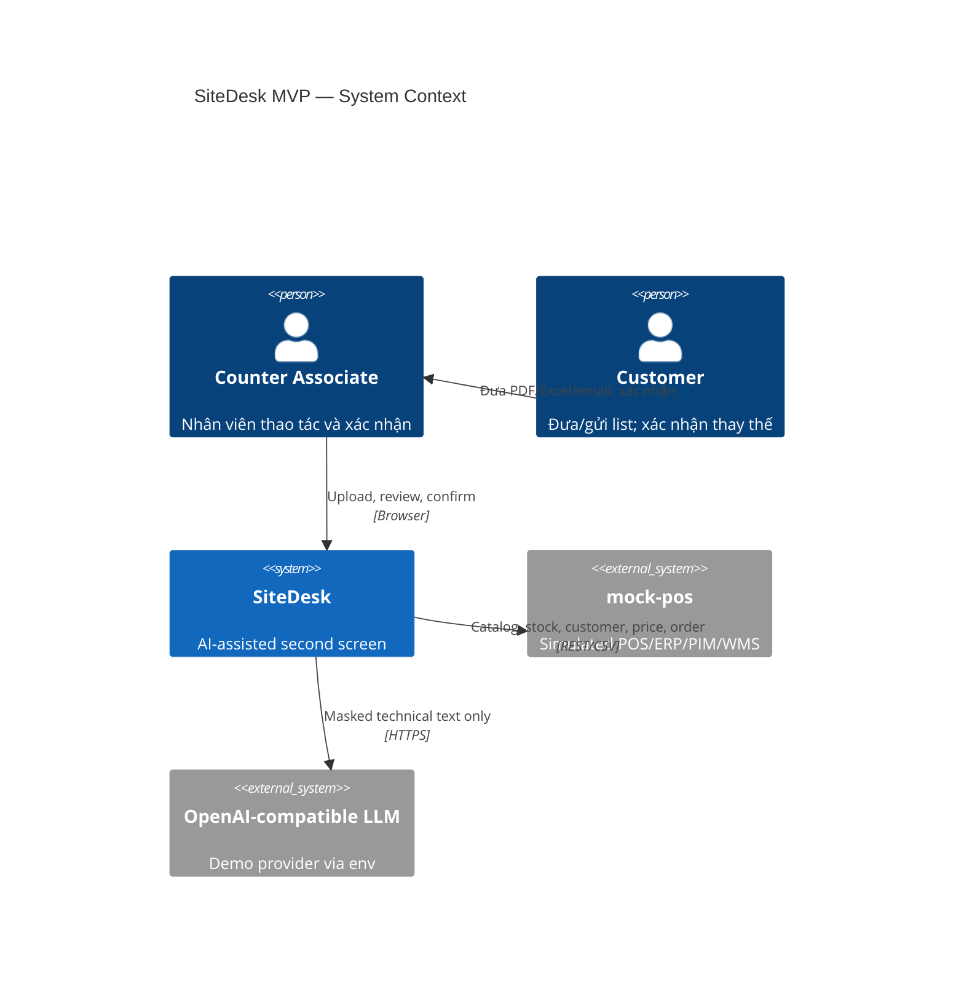
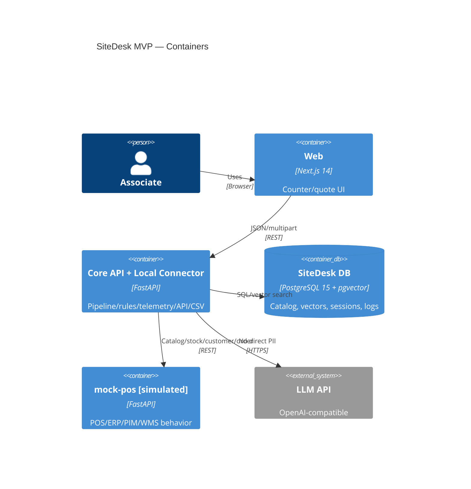
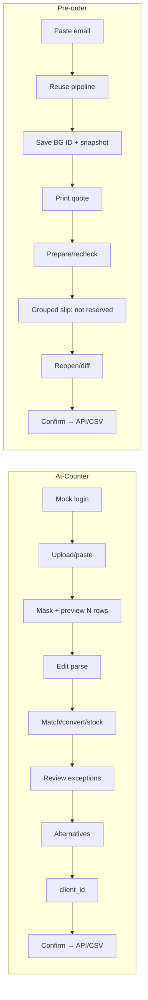
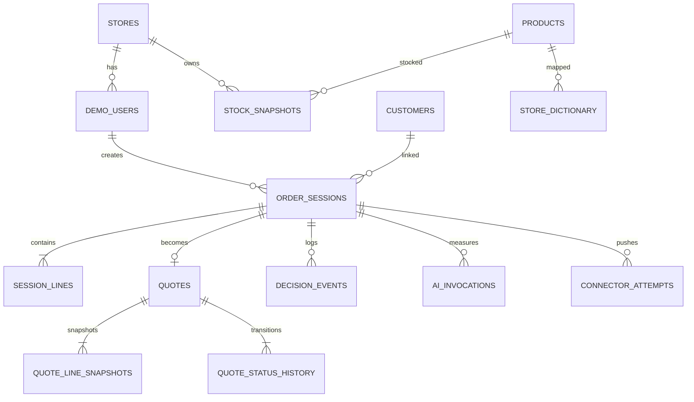

# SiteDesk — Software Requirements Specification cho MVP Round 2

**Phiên bản:** 1.0 · **Ngày chốt:** 03/11/2026 · **Hạn nộp:** 22:00 GMT+7, 09/11/2026  
**Trạng thái:** Implementation-ready baseline · **Thị trường demo:** DK / DKK

> Các số 12 phút, `<2 phút`, `≥30%`, `≥70%` là mục tiêu/giả định Round 1, chưa phải kết quả đo. MVP chạy local; POS/ERP/SSO/catalog/stock/price đều **simulated**. Không ghi secret vào repo hoặc tài liệu.

---

## 1. Mục đích, phạm vi, định nghĩa và truy vết Round 1

### 1.1 Mục đích và phạm vi

SiteDesk là web “second screen” cho nhân viên quầy Company A: nhận PDF, Excel/CSV hoặc text/email; che PII; bóc tách; khớp SKU; quy đổi selling unit; đọc tồn; đề xuất thay thế; nhân viên duyệt; đẩy payload qua Local Connector hoặc CSV fallback.

Hai luồng: **At-Counter** (UC1 → UC4 → UC2 → UC3) và **Pre-order / Advance Quote** (UC5). UC5 chỉ nhận email do nhân viên dán, không có khách tự đặt “online”. Phạm vi giữ UC1–UC5, FR-01–07, NFR-01–07, payload slide 9, ba KPI slide 10, Core & Connector. Ngoài phạm vi: §14.

### 1.2 Thuật ngữ

| Thuật ngữ | Nghĩa |
|---|---|
| Match score | Điểm xếp hạng `[0,1]`, không phải xác suất. |
| Zero-touch | Score `≥0.90` và không sửa parse/SKU/quantity/unit/substitution. |
| On-hand | Tồn tổng cửa hàng, không phải ATP, không có vị trí kệ. |
| Must-match | Thuộc tính kỹ thuật không được lệch theo nhóm hàng. |
| Core | Frontend, Backend, PostgreSQL/pgvector dùng chung. |
| Local Connector | Adapter API/CSV theo thị trường; MVP gọi `mock-pos`. |
| PII | Email, điện thoại, tên, địa chỉ; `client_id` là pseudonymous. |
| Quote snapshot | Giá/tồn lúc lưu; không giữ chỗ. |

### 1.3 Nguồn và ưu tiên

1. `SiteDesk_SRS_10_Slides_EN.pptx` (cam kết đã nộp).
2. `SiteDesk_SRS.md` khi slide không nêu.
3. Đề Round 2 PDF.
4. `SiteDesk_Flow_Review.md`, nhưng D01–D25 thắng.
5. Scaffold hiện tại.

### 1.4 Truy vết Round 1 → MVP

| Round 1 | Requirement MVP |
|---|---|
| UC1 | MVP-FR-001..010 |
| UC2 | MVP-FR-014..016 |
| UC3 | MVP-FR-010, 017..020 |
| UC4 | MVP-FR-006..013, 021 |
| UC5 | MVP-FR-022..028 |
| FR-01 | MVP-FR-001..005 |
| FR-02 | MVP-FR-006..010 |
| FR-03 | MVP-FR-011..013 |
| FR-04 | MVP-FR-014..016 |
| FR-05 | MVP-FR-017..020 |
| FR-06 | MVP-FR-022..028 |
| FR-07 | MVP-FR-021, 029..031 |
| NFR-01 | MVP-NFR-001 |
| NFR-02 | MVP-FR-002, 032; MVP-NFR-002 |
| NFR-03 | MVP-NFR-003 |
| NFR-04 | MVP-FR-010; MVP-NFR-004 |
| NFR-05 | MVP-NFR-005 |
| NFR-06 | MVP-FR-003, 019, 033; MVP-NFR-006 |
| NFR-07 | MVP-FR-034; MVP-NFR-007 |

### 1.5 Changes since Round 1

- “Confidence” hiện thực thành **match score**, hard constraints, ba dải và evaluation.
- “Zero PII Storage/Zero Personal Data” được làm rõ: không gửi direct PII cho AI; lưu `client_id` pseudonymous; source **đã che** giữ đến Confirm/quote expiry; log phi PII giữ lâu dài.
- EU/EEA là production target. Demo dùng provider theo env, không claim sovereign khi chưa xác minh. DeepSeek official API không dùng cho tuyên bố sovereign; production hướng self-host open-weights tại EU/EEA.
- PostgreSQL 15 + pgvector; embedding local; `mock-pos` riêng là chi tiết triển khai Core & Connector.
- “30-second review” là phần ngoại lệ; toàn bảng vẫn hiện. Partial stock như stockout. Quote không giữ chỗ.
- SSO/POS/ERP/catalog/stock/price của MVP là simulated; giới hạn ở §14.

---

## 2. Kiến trúc và luồng dữ liệu

### 2.1 Containers

| Container | Công nghệ/cổng | Trách nhiệm |
|---|---|---|
| Web | Next.js 14/TypeScript/Tailwind, `:3000` | Login mock, intake, review, quote/print |
| Core API | FastAPI, `:8000` | Parser, PII, AI Gateway, matching, conversion, alternatives, connector, telemetry |
| DB | PostgreSQL 15 + pgvector, `:5432` | Catalog/vector/session/quote/dictionary/audit |
| mock-pos | FastAPI, giả định `:8001` | **Simulated** POS/ERP/PIM/WMS, price/order, `FAIL_MODE` |
| LLM | OpenAI-compatible, env | Chỉ parse khó, extract mơ hồ, rerank score `<.80`; masked text |

Embedding mặc định `intfloat/multilingual-e5-small`: đa ngôn ngữ, 384 dimensions, nhỏ hơn `bge-m3`, phù hợp CPU. **Giả định cần benchmark:** weights khoảng 0.5 GB, batch 20 dòng ≤0.8 s; không đạt thì ONNX/quantization. Đổi model/dimension phải chạy `scripts/reindex_catalog.py`.

### 2.2 C4 Level 1 — Mermaid



### 2.3 C4 Level 2 — Mermaid



### 2.4 Sequence Analyze/Confirm

```mermaid
sequenceDiagram
actor A as Associate
participant W as Web
participant C as Core API
participant D as PostgreSQL+pgvector
participant L as LLM (conditional)
participant P as mock-pos (simulated)
A->>W: Upload/paste
W->>C: POST analyze
C->>C: extract → mask → rules
opt ambiguous and AI available
C->>L: masked text + schema
L-->>C: JSON
end
C->>D: vector top-10 + dictionary
C->>C: hard rules → score → conversion
C->>P: GET stock
C->>D: persist lines/telemetry
C-->>W: preview/candidates/stock
A->>W: resolve + Confirm
W->>C: POST confirm (Idempotency-Key)
C->>D: validate/lock
C->>P: POST /orders
alt success
P-->>C: pos_order_ref
C->>D: PUSHED; dictionary; purge source
else 503/timeout
C->>C: generate CSV
C->>D: CSV_FALLBACK; dictionary; purge source
end
C-->>W: immutable status/ref/download
```

### 2.5 User Journey — hai luồng



AI Gateway có `LLMProvider`, `EmbeddingProvider`. Connector có `CONNECTOR_MODE=api|csv`; API fail luôn phát CSV.

---

## 3. Actors, hai luồng và nhánh lỗi

### 3.1 Actors

| Actor | Quyền/trách nhiệm |
|---|---|
| Associate | Login mock; tạo/sửa/duyệt; quote; Confirm; gỡ store mapping. |
| Customer | Ngoài hệ thống; đưa list, quyết định thay thế. |
| mock-pos | External simulated source/receiver. |
| LLM provider | External optional processor, masked text only. |

### 3.2 At-Counter

1. Login mock; resume draft server-side của user/store.
2. Upload PDF/XLSX/CSV hoặc paste; hiện masked source, “Đã đọc N dòng”, kể cả unreadable.
3. Sửa `item_text`, `requested_qty`, `requested_unit`; Analyze.
4. Khớp/quy đổi/tồn; exceptions trước nhưng đủ dòng.
5. Partial/out: xem ≤2 alternatives; chọn hoặc ghi lý do.
6. Resolve mọi dòng `<.80`; chọn client hoặc `<STORE>-WALKIN`.
7. Confirm idempotent, read-only; API fail → CSV. AI fail → rules/full-text search vẫn Confirm.

State: `DRAFT → PARSED → ANALYZED → REVIEW_REQUIRED → READY_TO_CONFIRM → CONFIRMED → PUSHED|CSV_FALLBACK`.

### 3.3 Pre-order / Advance Quote

Paste email → clean/mask → pipeline At-Counter → lưu `BG-<COUNTRY>-<4 digits>` + client/validity/price-stock snapshot → print quote → Prepare recheck/diff/alternatives → print slip nhóm category với **“chưa giữ chỗ trên hệ thống”** → reopen → Confirm. Expiry tính khi read/write, không scheduler.

State: `SAVED → SENT → PREPARING → COLLECTED | EXPIRED`, có actor/time. Không versioning, reservation, warehouse UI, scheduler/badge.

### 3.4 Nhánh lỗi chung

| Lỗi | Hành vi |
|---|---|
| AI fail / `AI_FAIL_MODE=true` | Banner; rules text/XLSX/CSV, PDF text extraction, full-text search; Confirm được. |
| POS 503/timeout | CSV tự động, `CSV_FALLBACK`, retry/download idempotent. |
| Scan-only/unsupported | 422, hướng dẫn paste/gõ; không OCR. |
| Unknown unit/missing attr | Vàng; không đoán/convert; phải resolve. |
| DB unavailable | 503; không báo lưu/Confirm thành công. |

---

## 4. Yêu cầu chức năng chi tiết

| ID | Yêu cầu | Ưu tiên | Trace | Tiêu chí chấp nhận kiểm chứng được |
|---|---|---:|---|---|
| MVP-FR-001 | Nhận PDF text/XLSX/CSV/text/email; session server-side. | P0 | UC1, FR-01 | Fixture hợp lệ trả session/masked preview/rows; scan-only 422. |
| MVP-FR-002 | Mask PII trước AI; bỏ signature/header khi khả thi. | P0 | UC1, FR-01, NFR-02 | Provider spy không thấy email/phone; UI thấy mask; audit masker version. |
| MVP-FR-003 | AI lỗi vẫn rules parse/manual full-text. | P0 | UC1, NFR-06 | Fail mode: text/XLSX/CSV tạo rows, banner, chọn SKU/Confirm được. |
| MVP-FR-004 | Preview/source highlight/N rows; editable name/qty/unit. | P0 | UC1, FR-01 | Count đúng; edit persist; highlight đúng span. |
| MVP-FR-005 | Không bỏ unreadable; unknown unit, `N x L` flag. | P0 | UC1, FR-01 | Malformed→UNREADABLE; `10 x 4.8m` đúng N/L+flag; unknown không map. |
| MVP-FR-006 | Extract attrs rules+dictionary+LLM khi cần. | P0 | UC1, UC4, FR-02 | Golden attrs + provenance; không nêu→null/no penalty. |
| MVP-FR-007 | pgvector top-10; alias/dictionary boost, hard rules thắng. | P0 | UC1, UC4, FR-02, FR-07 | ≤10; must mismatch không >.60 dù mapping hit. |
| MVP-FR-008 | Hybrid match, must-match, reasons, 3 candidates. | P0 | UC1, UC4, FR-02 | Mismatch loại/cap; response đủ score/reasons/≤3. |
| MVP-FR-009 | Bands ≥.90/.80–<.90/<.80; gap `<.05` cap .89. | P0 | UC1, UC4, FR-02 | Boundary/gap tests đúng. |
| MVP-FR-010 | Exceptions first, đủ bảng; yellow bắt buộc; keyboard; ≤4 chips. | P0 | UC3, UC4, NFR-04 | Yellow chặn Confirm; green vẫn DOM; shortcut/chip tests pass. |
| MVP-FR-011 | Normalize unit DA/NO/SV/EN. | P0 | UC4, FR-03 | §15 fixtures map; unknown giữ raw+flag. |
| MVP-FR-012 | Catalog conversion/ceil; không waste. | P0 | UC4, FR-03 | 120/4.8=25; 60/2.88→21; giữ formula/rounded. |
| MVP-FR-013 | Thiếu conversion attr thì block, không đoán. | P0 | UC4, FR-03 | Missing pack_size→BLOCKED/reason/no guessed qty. |
| MVP-FR-014 | On-hand/timestamp; IN/PARTIAL/OUT; partial như out. | P0 | UC2, FR-04, NFR-06 | Need25/on_hand10 hiện partial+alternatives; không shelf. |
| MVP-FR-015 | Alternative equal/superior, đủ qty, ≤2, sort price delta. | P0 | UC2, FR-04 | Lower cert/grade/stock bị loại; output đúng sort. |
| MVP-FR-016 | Customer validation; grade label; reject reason. | P0 | UC2, FR-04, FR-07 | Ghi original/final/actor/time; reject bắt reason. |
| MVP-FR-017 | Existing client hoặc `<STORE>-WALKIN`. | P0 | UC3, FR-05 | Validate client; walk-in chọn được; payload không PII. |
| MVP-FR-018 | Confirm idempotent, validate, khóa. | P0 | UC3, FR-05 | Same replay same ref; changed replay 409; update locked 409. |
| MVP-FR-019 | API/CSV Connector; API lỗi tự CSV/status. | P0 | UC3, FR-05, NFR-06 | 201→PUSHED; 503→CSV_FALLBACK+download. |
| MVP-FR-020 | Payload đúng slide 9/selling unit. | P0 | UC3, FR-05 | Contract pass; substitution có original_sku. |
| MVP-FR-021 | Store dictionary sau Confirm/store scope/actor/deactivate. | P1 | UC4, FR-07 | Trước không record; sau có; deactivate bỏ boost. |
| MVP-FR-022 | UC5 dùng chung pipeline. | P1 | UC5, FR-06 | Cùng normalized line→cùng candidate order/config. |
| MVP-FR-023 | Quote ID/client/validity + snapshot. | P1 | UC5, FR-06 | Unique ID; line có time/price/on_hand; reload giữ. |
| MVP-FR-024 | Print quote/PDF browser + mark sent. | P1 | UC5, FR-06 | ID/currency/validity/lines/disclaimer; actor/time. |
| MVP-FR-025 | Prepare recheck và before→after. | P1 | UC5, FR-06 | Mutate mock→diff; stockout mới có alternatives. |
| MVP-FR-026 | Pick slip nhóm category, not-reserved notice. | P1 | UC5, FR-06 | Group đúng; exact disclaimer hiện. |
| MVP-FR-027 | Quote state/history/expiry, không scheduler. | P1 | UC5, FR-06, FR-07 | Illegal 409; expired on access; history append-only. |
| MVP-FR-028 | Confirm quote dùng connector + quote_id. | P1 | UC5, UC3, FR-05, FR-06 | Contract ID; success COLLECTED; fail CSV. |
| MVP-FR-029 | Log suggestion/decision/time/rejection, không PII. | P1 | FR-07 | E2E đủ events; privacy scan sạch. |
| MVP-FR-030 | Log token/latency/provider/model/cache. | P1 | FR-07 | Usage persist; local token=0; join session/line. |
| MVP-FR-031 | SQL ba KPI. | P1 | FR-07, KPI-01..03 | §10 chạy seed, không divide-zero. |
| MVP-FR-032 | Mock login/idle timeout/draft resume. | P1 | NFR-02 | Timeout login; same user/store resume; cross-store chặn. |
| MVP-FR-033 | Hai fail toggles độc lập. | P1 | NFR-06 | Env-only; health không secret; UI đúng mode. |
| MVP-FR-034 | AI Gateway interfaces/env; embedding đổi→reindex. | P0 | NFR-07 | Fake adapters; LLM swap không đổi UI; dimension fail-fast. |
| MVP-FR-035 | Seed D21. | P1 | UC1..5, FR-01..07 | 120..150; 6 category; 4 languages; stock/substitution/fixtures đủ. |

Không có normative P2 trong baseline: mọi tiện ích/polish P2 được phép cắt mà không làm hỏng hai journey; chỉ nhận P2 sau khi toàn P0/P1 acceptance pass. Đây là cách áp dụng D24, không nâng polish thành phạm vi mới.

---

## 5. Đặc tả pipeline AI

`extract → mask/clean → rule parse → optional LLM parse → normalize → attrs → optional LLM attrs → embed/top-10 → boosts → hard constraints/penalty → optional rerank score <.80 → bands → conversion → stock → alternatives`

| Config | Default | Ghi chú |
|---|---|---|
| `LLM_PROVIDER` | `openai_compatible` | Demo; production EU/EEA verified/self-hosted. |
| `LLM_BASE_URL/MODEL/API_KEY` | không hard-code | Secret chỉ `.env`. |
| `EMBEDDING_PROVIDER/MODEL` | `local` / e5-small | API optional; 384 dims. |
| High/review threshold | `.90` / `.80` | Chốt sau D22. |
| Ambiguity gap/cap | `.05` / `.89` | Gap `<`. |
| Must mismatch cap | `.60` | Safety mismatch loại. |
| Dictionary/optional | `+.05` / `×.95`, floor `.80` | Không bypass. |

`semantic=clamp((cosine+1)/2,0,1)`; alias boost ≤`.03`. `base=clamp(semantic+alias+dictionary,0,1)`; `penalty=max(.80,.95^optional_mismatches)`; `score=base×penalty`. Must mismatch loại/cap `.60`; missing request attr không phạt. Top gap `<.05` cap `.89`.

```pseudo
attrs=rules(text); if ambiguous and ai_ok: attrs+=llm_extract(masked)
for c in vector_top_k(embed("query: "+normalized),10):
  reasons=compare(attrs,c.specs,MUST_MATCH[c.category])
  if safety_mismatch or incompatible: continue
  score=clamp(scale(c.cosine)+aliasBoost+dictBoost,0,1)*max(.80,.95^optionalMismatchCount)
  if must_mismatch: score=min(score,.60)
  ranked.add(c,score,reasons)
sort score desc, sku asc; if top1-top2<.05: top1=min(top1,.89)
if top1<.80 and ai_ok: rerank_only_existing_top10(adjustment_limit=.05)
return top3
```

Must-match: timber (cross-section, strength grade); gypsum (thickness, type); cement/mortar (bag weight, type/grade); insulation (thickness); decking (cross-section, treatment). Accessories xem OI-05. Optional brand/color phạt nhẹ.

`N x L` → N cây dài L + review. `selling_qty=ceil(requested_qty/pack_size)`; direct-compatible giữ qty; không waste; thiếu attr block. Alternative cùng function, equal/superior certification, đủ stock, sort abs price delta, 0..2. Dictionary chỉ sau Confirm/store scope.

Comparator dùng taxonomy version hóa, không so chuỗi tự do:

| Thuộc tính | Quy tắc `candidate >= original` |
|---|---|
| Strength grade | `C14=14, C16=16, C18=18, C24=24, C30=30`; khác hệ grade → loại. |
| Fire class | Cùng Euroclass, rank cấu hình `A1>A2>B>C>D>E>F`; suffix/smoke phải bằng/tốt hơn; thiếu → loại. |
| Moisture | Original `moisture_resistant=true` bắt buộc candidate true. |
| Treatment | Capability set của candidate phải là superset requirement gốc. |
| Dimension/thickness/bag weight | Bằng chính xác normalized; tolerance mặc định 0. |

```pseudo
safe(candidate, original, need):
  require same functional_category
  for must_attribute:
    require both values present
    exact -> require candidate == original
    ordered -> require rank(candidate) >= rank(original)
    capability_set -> require candidate contains_all original.required
  require candidate.on_hand >= need
  return true
```

Taxonomy/rank phải domain-validate (OI-05); không comparable thì fail closed.

Mask order: email → phone → headers → quote/signature → heuristic name/address → preview. LLM JSON strict, một repair retry, rồi rules-only; không override hard rules.

```text
PARSE SYSTEM: Input is PII-masked. Extract material rows; do not infer missing values; preserve unreadable; JSON only.
PARSE USER: {"language_hint":"DA|NO|SV|EN","masked_text":"{{text}}"}
OUTPUT: {"rows":[{"source_text":"string","item_text":"string|null","quantity":null,"unit_raw":null,"status":"OK|UNREADABLE","source_start":0,"source_end":1,"warnings":[]}]}
```

```text
ATTR SYSTEM: Extract only explicit dimensions/grade/thickness/material/treatment/length/brand. Never upgrade grade/certification. JSON only, with evidence substrings.
ATTR USER: {"category_hint":"{{category|null}}","masked_line":"{{text}}"}
ATTR OUTPUT SCHEMA: {"dimensions_mm":{"width":"number|null","height":"number|null"},"strength_grade":"string|null","thickness_mm":"number|null","material":"string|null","treatment":"string|null","length_m":"number|null","brand":"string|null","evidence":{"<field>":"exact substring"}}
```

```text
RERANK SYSTEM: Rank only supplied top-10; hard constraints authoritative; adjustment [-.05,.05]; return {"ranking":[{"sku":"...","relevance_adjustment":0,"reasons":[]}]}
RERANK USER: {"request":{"masked_text":"{{text}}","attributes":{}},"candidates":[{"sku":"string","base_score":0.0,"technical_specs":{},"hard_rule_result":"PASS|CAPPED"}]}
RERANK OUTPUT: every input candidate appears once; no new SKU; adjustment in [-0.05,0.05].
```

Cache SHA-256(normalized masked text + language + prompt/model/catalog version), TTL giả định 24h (OI-06). Log token/latency/cache; rules/local token 0. Monthly/store caps chuyển degraded mode, không chặn manual workflow.

---

## 6. Mô hình dữ liệu, DDL, ERD, retention và seed

### 6.1 DDL PostgreSQL đề xuất

```sql
CREATE EXTENSION IF NOT EXISTS vector;
CREATE TYPE session_status AS ENUM ('DRAFT','PARSED','ANALYZED','REVIEW_REQUIRED','READY_TO_CONFIRM','CONFIRMED','PUSHED','CSV_FALLBACK');
CREATE TYPE quote_status AS ENUM ('SAVED','SENT','PREPARING','COLLECTED','EXPIRED');
CREATE TABLE stores (store_id varchar(32) PRIMARY KEY, country char(2) NOT NULL, currency char(3) NOT NULL, timezone text NOT NULL);
CREATE TABLE demo_users (user_id varchar(32) PRIMARY KEY, store_id varchar(32) REFERENCES stores, display_name text NOT NULL, password_hash text NOT NULL, active boolean NOT NULL DEFAULT true);
CREATE TABLE customers (client_id varchar(64) PRIMARY KEY, customer_type text NOT NULL CHECK(customer_type IN ('B2B','B2C_WalkIn')), discount_tier text NOT NULL, store_id varchar(32) REFERENCES stores);
CREATE TABLE discount_tiers (tier_code text PRIMARY KEY, market char(2) NOT NULL, discount_rate numeric(6,5) NOT NULL CHECK(discount_rate BETWEEN 0 AND 1), valid_from date NOT NULL, simulated boolean NOT NULL DEFAULT true);
CREATE TABLE products (
 sku varchar(64) PRIMARY KEY, market char(2) NOT NULL, name text NOT NULL, category text NOT NULL,
 selling_unit text NOT NULL, pack_size numeric(14,4), currency char(3) NOT NULL,
 unit_price numeric(14,2) NOT NULL CHECK(unit_price>=0), technical_specs jsonb NOT NULL DEFAULT '{}',
 aliases jsonb NOT NULL DEFAULT '{}', active boolean NOT NULL DEFAULT true,
 embedding vector(384), catalog_version text NOT NULL, updated_at timestamptz NOT NULL);
CREATE INDEX products_category_idx ON products(category,market) WHERE active;
CREATE INDEX products_specs_idx ON products USING gin(technical_specs);
CREATE INDEX products_embedding_idx ON products USING hnsw (embedding vector_cosine_ops);
CREATE TABLE stock_snapshots (store_id varchar(32) REFERENCES stores, sku varchar(64) REFERENCES products, on_hand numeric(14,3) NOT NULL CHECK(on_hand>=0), updated_at timestamptz NOT NULL, PRIMARY KEY(store_id,sku));
CREATE TABLE order_sessions (
 session_id uuid PRIMARY KEY, order_session_id varchar(64) UNIQUE NOT NULL, store_id varchar(32) REFERENCES stores,
 user_id varchar(32) REFERENCES demo_users, client_id varchar(64) REFERENCES customers,
 status session_status NOT NULL DEFAULT 'DRAFT', input_type text NOT NULL, masked_source text,
 source_delete_at timestamptz, ai_fail_mode boolean NOT NULL DEFAULT false,
 created_at timestamptz NOT NULL DEFAULT now(), last_activity_at timestamptz NOT NULL DEFAULT now(),
 confirmed_at timestamptz, processing_started_at timestamptz, processing_finished_at timestamptz,
 push_status text, pos_order_ref text, csv_object_key text);
CREATE INDEX order_sessions_resume_idx ON order_sessions(user_id,store_id,last_activity_at DESC) WHERE confirmed_at IS NULL;
CREATE TABLE session_lines (
 line_id uuid PRIMARY KEY, session_id uuid NOT NULL REFERENCES order_sessions ON DELETE CASCADE,
 line_no int NOT NULL, source_start int, source_end int, raw_customer_input text NOT NULL,
 parsed_name text, requested_qty numeric(14,4), requested_unit text, parse_status text NOT NULL,
 attributes jsonb NOT NULL DEFAULT '{}', original_sku varchar(64) REFERENCES products,
 final_sku varchar(64) REFERENCES products, match_score numeric(5,4) CHECK(match_score BETWEEN 0 AND 1),
 score_band text, reasons jsonb NOT NULL DEFAULT '[]', candidates jsonb NOT NULL DEFAULT '[]',
 selling_qty numeric(14,4), selling_unit text, conversion_formula text, rounded boolean NOT NULL DEFAULT false,
 stock_status text, on_hand numeric(14,3), stock_updated_at timestamptz, fulfillment_action text,
 associate_edited boolean NOT NULL DEFAULT false, resolved boolean NOT NULL DEFAULT false,
 substitution_rejection_reason text, UNIQUE(session_id,line_no));
CREATE INDEX session_lines_session_idx ON session_lines(session_id,line_no);
CREATE TABLE quotes (
 quote_id varchar(32) PRIMARY KEY, session_id uuid UNIQUE REFERENCES order_sessions,
 client_id varchar(64) REFERENCES customers, status quote_status NOT NULL DEFAULT 'SAVED',
 valid_until date NOT NULL, applied_discount_tier text NOT NULL,
 created_by varchar(32) REFERENCES demo_users, created_at timestamptz NOT NULL DEFAULT now(), updated_at timestamptz NOT NULL DEFAULT now());
CREATE TABLE quote_line_snapshots (quote_id varchar(32) REFERENCES quotes ON DELETE CASCADE, line_id uuid REFERENCES session_lines, sku varchar(64) REFERENCES products, unit_price numeric(14,2) NOT NULL, on_hand numeric(14,3) NOT NULL, captured_at timestamptz NOT NULL, PRIMARY KEY(quote_id,line_id));
CREATE TABLE quote_status_history (id bigserial PRIMARY KEY, quote_id varchar(32) REFERENCES quotes, from_status quote_status, to_status quote_status NOT NULL, actor_id varchar(32) REFERENCES demo_users, occurred_at timestamptz NOT NULL DEFAULT now());
CREATE TABLE store_dictionary (
 id bigserial PRIMARY KEY, store_id varchar(32) REFERENCES stores, normalized_phrase text NOT NULL,
 mapped_sku varchar(64) REFERENCES products, boost numeric(4,3) NOT NULL DEFAULT .05 CHECK(boost BETWEEN 0 AND .20),
 source_line_id uuid REFERENCES session_lines, created_by varchar(32) REFERENCES demo_users,
 created_at timestamptz NOT NULL DEFAULT now(), active boolean NOT NULL DEFAULT true,
 deactivated_by varchar(32) REFERENCES demo_users, deactivated_at timestamptz,
 UNIQUE(store_id,normalized_phrase,mapped_sku));
CREATE INDEX store_dictionary_lookup_idx ON store_dictionary(store_id,normalized_phrase) WHERE active;
CREATE TABLE decision_events (
 event_id bigserial PRIMARY KEY, session_id uuid REFERENCES order_sessions, line_id uuid REFERENCES session_lines,
 event_type text NOT NULL, actor_id varchar(32), suggested_sku varchar(64), selected_sku varchar(64),
 match_score numeric(5,4), reason_code text, metadata jsonb NOT NULL DEFAULT '{}', occurred_at timestamptz NOT NULL DEFAULT now());
CREATE INDEX decision_events_kpi_idx ON decision_events(event_type,occurred_at);
CREATE TABLE ai_invocations (
 invocation_id bigserial PRIMARY KEY, session_id uuid REFERENCES order_sessions, line_id uuid REFERENCES session_lines,
 step text NOT NULL, provider text NOT NULL, model text NOT NULL, prompt_version text NOT NULL,
 input_tokens int NOT NULL DEFAULT 0, output_tokens int NOT NULL DEFAULT 0,
 latency_ms int NOT NULL CHECK(latency_ms>=0), cache_hit boolean NOT NULL DEFAULT false,
 status text NOT NULL, occurred_at timestamptz NOT NULL DEFAULT now());
CREATE TABLE connector_attempts (
 attempt_id bigserial PRIMARY KEY, session_id uuid REFERENCES order_sessions, mode text NOT NULL,
 idempotency_key text NOT NULL, request_hash text NOT NULL, http_status int, result_ref text,
 created_at timestamptz NOT NULL DEFAULT now(), UNIQUE(idempotency_key));
```

Password demo chỉ lưu hash. Money dùng decimal, không Float. `csv_object_key` không chứa secret.

### 6.2 ERD



### 6.3 Retention và seed

- `masked_source`/file đã mask: xóa transactionally sau Confirm; quote xóa khi EXPIRED. Draft abandon xem OI-02.
- Parsed non-PII/decision/KPI: giữ cho pilot; production retention xem OI-03.
- Không persist LLM body; chỉ metrics/provenance. Quote expiry không scheduler: lifecycle khi access hoặc manual maintenance.
- Seed ở `backend/seeds/`: `products.jsonl` (120–150), `stock.csv`, `customers.json`, `discount_tiers.json`, aliases, 4 fixtures, `evaluation.jsonl`. `discount_tiers.json` có 2–3 object `{tier_code,market,discount_rate,valid_from,simulated:true}`; tên/rate cụ thể là open item OI-08. Generator deterministic với seed giả định `2026`.
- `demo_users.json` có **giả định** ít nhất 2 account cho store DK demo; password được hash qua seed/setup và phát riêng cho team, không ghi trong SRS/repo.
- Validator bắt buộc 6 nhóm, aliases DA/NO/SV/EN, structured specs, stock 0/low, ≥1 substitute hợp lệ, ≥1 no-safe-alternative, 3 B2B + walk-in, 2–3 tiers. DK/DKK default; NO/SE configurable. Giá simulated.

---

## 7. Đặc tả API, payload và CSV

Base `/api/v1`; UTF-8; UUID; ISO-8601 UTC; decimal money. Error chuẩn:

```json
{"error":{"code":"UNRESOLVED_LINES","message":"Còn 2 dòng cần chọn SKU trước khi Confirm","details":{"line_nos":[3,7]},"request_id":"req_..."}}
```

Mã: 400 state, 401 mock auth, 404, 409 idempotency/state, 413 limit OI-04, 422 validation/no text, 429 AI budget (degrade), 502 LLM, 503 dependency.

### 7.1 Core endpoints

| Method/path | Request | Success |
|---|---|---|
| `POST /auth/login` | `{username,password}` | mock cookie + user/store |
| `POST /auth/logout` | — | 204 |
| `POST /sessions` | `{input_type,market}` | identifiers/status |
| `POST /sessions/{id}/ingest` | multipart hoặc `{text}` | masked preview + rows |
| `PATCH /sessions/{id}/lines/{line}` | editable fields | line |
| `POST /sessions/{id}/analyze` | `{language_hint}` | results |
| `GET /catalog/search?q=&store_id=` | — | full-text results |
| `PUT /sessions/{id}/lines/{line}/selection` | `{sku,decision,reason}` | resolved line |
| `GET /sessions/{id}/lines/{line}/alternatives` | — | 0..2 alternatives |
| `POST /sessions/{id}/confirm` | slide-9 payload + `Idempotency-Key` | push/ref or CSV URL |
| `POST /quotes` | session/client/validity | quote + snapshots |
| `GET /quotes/{quote_id}` | — | quote + live changes |
| `POST /quotes/{id}/transitions` | `{to_status}` | state/history |
| `POST /quotes/{id}/prepare` | — | recheck + print URL |
| `GET /quotes/{id}/print?kind=quote|pick-slip` | — | print HTML |
| `DELETE /store-dictionary/{id}` | — | deactivate/audit |
| `GET /health` | — | dependencies/degraded flags, no secret |

Các contract JSON tối thiểu (field không nêu là không được tự thêm PII):

```json
{"login_request":{"username":"associate.dk.1","password":"<entered-at-runtime>"},
 "login_response":{"user_id":"EMP-1042","store_id":"DK-CPH-04","display_name":"Demo Associate","idle_timeout_seconds":300}}
```

```json
{"ingest_text_request":{"text":"[EMAIL] ... 10 stk timber 45x95 C24","language_hint":"DA"},
 "ingest_response":{"session_id":"uuid","masked_source":"[EMAIL] ...","read_line_count":1,"rows":[{"line_no":1,"source_start":12,"source_end":40,"item_text":"timber 45x95 C24","quantity":10,"unit_raw":"stk","status":"OK","warnings":[]}]}}
```

```json
{"line_patch_request":{"item_text":"timber 45x95 C24","requested_qty":120,"requested_unit":"m"},
 "line_patch_response":{"line_no":1,"version":2,"parse_status":"OK","requires_reanalysis":true}}
```

```json
{"selection_request":{"sku":"SKU-DK-4595-480","decision":"SKU_KEPT|SKU_EDITED|SUBSTITUTION_ACCEPTED|SUBSTITUTION_REJECTED","reason":"string|null"},
 "selection_response":{"line_no":1,"final_sku":"SKU-DK-4595-480","resolved":true,"fulfillment_action":"direct_pick"}}
```

```json
{"alternatives_response":{"line_no":4,"needed_quantity":15,"items":[{"sku":"SKU-ISOVER-095","match_score":0.94,"on_hand":42,"unit_price":125.50,"currency":"DKK","unit_price_delta":5.00,"total_price_delta":75.00,"different_grade":false,"reasons":["same thickness","moisture class not lower"]}],"message":null}}
```

```json
{"quote_create_request":{"session_id":"uuid","client_id":"C-88921","valid_until":"2026-11-10"},
 "quote_response":{"quote_id":"BG-DK-0457","status":"SAVED","client_id":"C-88921","valid_until":"2026-11-10","applied_discount_tier":"TRADE_2","snapshot_at":"2026-11-03T09:00:00Z","lines":[{"line_no":1,"sku":"SKU-DK-4595-480","unit_price":100.00,"on_hand":140}]}}
```

```json
{"quote_transition_request":{"to_status":"SENT"},"quote_transition_response":{"quote_id":"BG-DK-0457","from_status":"SAVED","to_status":"SENT","actor_id":"EMP-1042","occurred_at":"2026-11-03T09:05:00Z"},
 "prepare_response":{"quote_id":"BG-DK-0457","status":"PREPARING","changes":[{"line_no":1,"price":{"before":100.00,"after":105.00},"stock":{"before":140,"after":20},"alternative_required":true}],"print_url":"/api/v1/quotes/BG-DK-0457/print?kind=pick-slip"}}
```

```json
{"confirm_response":{"order_session_id":"SD-2026-DK-99412","push_status":"PUSHED","pos_order_ref":"POS-DK-000123","csv_download_url":null,"locked":true},
 "confirm_csv_response":{"order_session_id":"SD-2026-DK-99412","push_status":"CSV_FALLBACK","pos_order_ref":null,"csv_download_url":"/api/v1/sessions/uuid/export.csv","locked":true}}
```

```json
{"session_create_request":{"input_type":"paste_text","market":"DK"},
 "session_create_response":{"session_id":"uuid","order_session_id":"SD-2026-DK-99412","status":"DRAFT","store_id":"DK-CPH-04"},
 "analyze_request":{"language_hint":"DA"},
 "catalog_search_response":{"items":[{"sku":"SKU-DK-4595-480","name":"Timber 45x95 C24 4.8m","category":"timber","selling_unit":"piece_4.8m","key_specs":{"cross_section_mm":"45x95","strength_grade":"C24"}}],"next_cursor":null}}
```

```json
{"quote_reopen_response":{"quote_id":"BG-DK-0457","status":"SENT","valid_until":"2026-11-10","applied_discount_tier":"TRADE_2","lines":[{"line_no":1,"sku":"SKU-DK-4595-480","snapshot":{"unit_price":100.00,"on_hand":140},"live":{"unit_price":105.00,"on_hand":20,"checked_at":"2026-11-03T12:00:00Z"},"changed_fields":["price","stock"],"alternative_required":true}],"status_history":[]},
 "dictionary_deactivate_response":{"id":42,"active":false,"deactivated_by":"EMP-1042","deactivated_at":"2026-11-03T12:05:00Z"},
 "health_response":{"status":"degraded|healthy","database":"up","embedding":"up","llm":"up|down|disabled","mock_pos":"up|down","ai_fail_mode":false}}
```

Multipart ingest dùng part `file`; chỉ một file/request; pagination catalog dùng `limit` mặc định 20/tối đa 50 và opaque `cursor`; quote exact lookup không pagination. Mọi mutation validate session/store ownership và state.

Analyze response mẫu:

```json
{"session_id":"7a61...","status":"REVIEW_REQUIRED","read_line_count":1,"ai_degraded":false,
 "lines":[{"line_no":1,"source":{"text":"Timber 45x95 C24 - 120 m","start":0,"end":27},
 "parsed":{"name":"Timber 45x95 C24","quantity":120,"unit":"linear_metre"},
 "match":{"sku":"SKU-DK-4595-480","match_score":0.98,"band":"HIGH","reasons":{"matched":["cross_section","C24"],"mismatched":[],"missing":["brand"]},"candidates":[]},
 "conversion":{"requested":"120 m","selling_quantity":25,"selling_unit":"piece_4.8m","formula":"120 ÷ 4.8 = 25","rounded":false},
 "stock":{"status":"IN_STOCK","on_hand":140,"updated_at":"2026-11-03T08:00:00Z"},"requires_review":false}]}
```

### 7.2 Payload chuẩn slide 9

```json
{"order_session_id":"SD-2026-DK-99412","quote_id":"BG-DK-0457","store_id":"DK-CPH-04",
 "client_id":"C-88921","confirmed_by_associate":"EMP-1042","processing_time_seconds":84,
 "line_items":[
  {"line_no":1,"raw_customer_input":"Timber 45x95 C24 - 120 m","final_sku":"SKU-DK-4595-480","quantity":25,"selling_unit":"piece_4.8m","confidence_score":0.98,"fulfillment_action":"direct_pick"},
  {"line_no":4,"raw_customer_input":"Rockwool FlexiBatts 95mm - 15 pk","original_sku":"SKU-RW-095","final_sku":"SKU-ISOVER-095","quantity":15,"fulfillment_action":"substituted"}]}
```

Tên `confidence_score` giữ legacy contract; UI/prose gọi match score. `quote_id` nullable At-Counter; substituted score nullable theo slide. `quantity` luôn selling unit của final SKU. `raw_customer_input` phải là phiên bản masked (OI-13).

### 7.3 mock-pos simulated (`:8001`)

| Endpoint | Response / hành vi |
|---|---|
| `GET /catalog?market=DK&updated_since=` | `{items:[{sku,name,category,selling_unit,pack_size,unit_price,currency,technical_specs,aliases}],catalog_version}` |
| `GET /stock?sku=&store_id=` | `{items:[{sku,on_hand,updated_at}]}`; 404 unknown |
| `GET /customers/{client_id}` | `{client_id,type,discount_tier,market}`; không PII |
| `POST /orders` | Slide-9 payload + idempotency; 201 `{pos_order_ref,status:"accepted",received_at}`; replay 200; mismatch 409 |
| `GET /health` | `{status,fail_mode}` |

Mock examples:

```json
{"catalog_response":{"items":[{"sku":"SKU-DK-4595-480","name":"Timber 45x95 C24 4.8m","category":"timber","selling_unit":"piece_4.8m","pack_size":4.8,"unit_price":100.00,"currency":"DKK","technical_specs":{"cross_section_mm":"45x95","strength_grade":"C24"},"aliases":{"da":["træ 45x95"]}}],"next_cursor":null,"catalog_version":"seed-2026-11-03"},
 "stock_response":{"items":[{"sku":"SKU-DK-4595-480","on_hand":140,"updated_at":"2026-11-03T08:00:00Z"}]},
 "customer_response":{"client_id":"C-88921","type":"B2B","discount_tier":"TRADE_2","market":"DK"}}
```

```json
{"order_request":"same as §7.2 payload","order_response":{"pos_order_ref":"POS-DK-000123","status":"accepted","received_at":"2026-11-03T09:10:00Z"},
 "error_response":{"error":{"code":"POS_SIMULATED_FAILURE","message":"mock-pos FAIL_MODE is enabled"}}}
```

Catalog supports `market`, `updated_since`, `limit≤50`, `cursor`; stock accepts repeated `sku` with maximum 50. Unknown customer/SKU → 404; invalid quantity/client/store → 422; idempotency payload mismatch → 409; fail mode → 503.

`FAIL_MODE=true`: business endpoints trả 503 `POS_SIMULATED_FAILURE`; health vẫn 200. `net_unit_price=list_unit_price×(1-discount_rate[tier])`; tier/rate ở seed, không hard-code Core.

### 7.4 CSV fallback

UTF-8 BOM, delimiter `;`, decimal `.`, RFC 4180 quote, một row/line. Header:

```csv
order_session_id;quote_id;store_id;client_id;confirmed_by_associate;processing_time_seconds;line_no;raw_customer_input;original_sku;final_sku;quantity;selling_unit;confidence_score;fulfillment_action
SD-2026-DK-99412;BG-DK-0457;DK-CPH-04;C-88921;EMP-1042;84;1;"Timber 45x95 C24 - 120 m";;SKU-DK-4595-480;25;piece_4.8m;0.98;direct_pick
```

Filename `SiteDesk_<order_session_id>_<UTC>.csv`; sanitize. Cell bắt đầu `=,+,-,@` được prefix `'` chống formula injection.

---

## 8. Đặc tả UI

| Screen | Nội dung |
|---|---|
| `/login` | Demo accounts, nhãn “Mock SSO”, idle notice; không hiện password. |
| `/` | Upload/Paste Email, constraints, masked source, Analyze, degraded banner. |
| `/sessions/[id]` | Source panel + review table, exception count, client, quote/Confirm. |
| `/quotes` | Exact quote search, status/filter; không scheduler badge. |
| `/quotes/[id]` | Snapshot/live diff, transitions, print, Confirm. |
| Print quote | Client ID, prices/tier/currency/validity/disclaimer. |
| Print slip | Quote/date, category groups, SKU/qty, “chưa giữ chỗ trên hệ thống”. |

Review columns: priority; raw/parsed; requested qty/unit; conversion/formula; SKU/name; ≤4 chips; match score/band; on-hand/timestamp; alternative/action.

| State | Tailwind | Nhãn |
|---|---|---|
| ≥.90 | `bg-emerald-50 border-emerald-500 text-emerald-900` | Khớp cao/check |
| .80–<.90 | `bg-green-50 border-green-400 text-green-900` | Kiểm nhanh/eye |
| <.80/unknown | `bg-amber-50 border-amber-500 text-amber-950` | Cần chọn/warning |
| Out/partial | `bg-red-50 border-red-500 text-red-900` | Hết/Thiếu một phần |
| Rounded | `bg-blue-50 text-blue-900` | Đã làm tròn lên |
| Degraded | `bg-amber-100 border-amber-600` | AI lỗi — tìm thủ công |

Chip emerald=khớp điều khách viết; slate=khách không nêu; red=lệch. `↑↓` row, `Tab` field, `Enter` open/commit, `Esc` close; focus `ring-2 ring-blue-600`. Loading có stage/skeleton; empty hướng dẫn; no match focus search; no alternative exact message; Confirm disabled liệt kê blockers; success read-only + POS ref/CSV. Không dùng màu làm tín hiệu duy nhất.

---

## 9. Yêu cầu phi chức năng đo được

| ID | Yêu cầu | Ưu tiên | Trace | Tiêu chí chấp nhận |
|---|---|---:|---|---|
| MVP-NFR-001 | Zero-install browser, Compose, stack chốt. | P0 | NFR-01 | Máy chỉ có Docker chạy command; Chrome/Edge mở :3000. |
| MVP-NFR-002 | No direct PII to AI; EU/EEA production target; isolation. | P0 | NFR-02 | Spy/privacy pass; demo không claim region; cross-store 403/404. |
| MVP-NFR-003 | 20-line analyze ≤3.0s sau warm-up. | P0 | NFR-03 | p95 ≥20 runs: extract/mask .35s, parse .45s, embed/retrieve .80s, rules/convert .45s, stock .35s, serialize/network .30s, contingency buffer .30s. Đây là target giả định; external LLM ngoài guarantee. |
| MVP-NFR-004 | Keyboard UI; onboarding target 5 phút. | P1 | NFR-04 | Scripted task không chuột + accessibility no-critical; 5-minute chỉ claim sau user test. |
| MVP-NFR-005 | High-band false-match ≤2%. | P0 | NFR-05 | ≥150 labels; score ≥.90 error; 0/n report upper95≈3/n; dưới 150 không claim đạt. |
| MVP-NFR-006 | AI manual fallback, POS CSV, stock timestamp. | P0 | NFR-06 | Fault E2E: Confirm under AI fail; CSV under POS fail; timestamp mọi stock. |
| MVP-NFR-007 | Provider/country modularity. | P0 | NFR-07 | Fake provider tests; LLM env-only; market Connector/config; language phải re-evaluate. |

Reliability/security: Confirm transaction + unique key; mock timeout giả định 2s/one retry (OI-07); magic bytes/content type; CORS allow `localhost:3000` thay `*`; HttpOnly/SameSite=Lax; structured logs redact secrets.

---

## 10. Telemetry và KPI

Events: `SESSION_CREATED`, `PARSE_EDITED`, `AI_SUGGESTED`, `SKU_KEPT`, `SKU_EDITED`, `SUBSTITUTION_ACCEPTED/REJECTED`, `CONFIRMED`, `POS_PUSHED`, `CSV_FALLBACK`, `QUOTE_SAVED/SENT/PREPARED/COLLECTED/EXPIRED`. Không PII.

```sql
-- Time-to-Serve
SELECT count(*) confirmed_sessions,
 percentile_cont(.5) WITHIN GROUP (ORDER BY EXTRACT(EPOCH FROM (confirmed_at-processing_started_at))) median_seconds,
 avg(EXTRACT(EPOCH FROM (confirmed_at-processing_started_at))) avg_seconds,
 count(*) FILTER(WHERE confirmed_at-processing_started_at < interval '120 seconds')::numeric/NULLIF(count(*),0) under_2m_rate
FROM order_sessions WHERE confirmed_at IS NOT NULL AND processing_started_at IS NOT NULL;

-- Substitution Acceptance: accepted / all stockout-or-partial lines (Round 1 denominator)
WITH eligible AS (
 SELECT line_id FROM session_lines sl JOIN order_sessions s USING(session_id)
 WHERE s.confirmed_at IS NOT NULL AND sl.stock_status IN ('PARTIAL','OUT_OF_STOCK')
), accepted AS (SELECT DISTINCT line_id FROM decision_events WHERE event_type='SUBSTITUTION_ACCEPTED'),
offered AS (SELECT DISTINCT line_id FROM decision_events WHERE event_type='AI_SUGGESTED' AND metadata->>'suggestion_type'='alternative')
SELECT count(a.line_id) accepted, count(e.line_id) total_stockouts,
 count(a.line_id)::numeric/NULLIF(count(e.line_id),0) acceptance_rate,
 count(o.line_id)::numeric/NULLIF(count(e.line_id),0) offered_rate
FROM eligible e LEFT JOIN accepted a USING(line_id) LEFT JOIN offered o USING(line_id);

-- Zero-touch
SELECT count(*) FILTER(WHERE match_score>=.90 AND associate_edited=false AND fulfillment_action='direct_pick') zero_touch_lines,
 count(*) confirmed_lines,
 count(*) FILTER(WHERE match_score>=.90 AND associate_edited=false AND fulfillment_action='direct_pick')::numeric/NULLIF(count(*),0) zero_touch_rate
FROM session_lines sl JOIN order_sessions s USING(session_id) WHERE s.confirmed_at IS NOT NULL;

-- AI usage/latency
SELECT date_trunc('month',occurred_at) month,provider,model,step,sum(input_tokens) input_tokens,
 sum(output_tokens) output_tokens,percentile_cont(.95) WITHIN GROUP(ORDER BY latency_ms) p95_ms,
 count(*) FILTER(WHERE cache_hit) cache_hits
FROM ai_invocations GROUP BY 1,2,3,4;
```

KPI denominator giữ ổn định; seed/demo metrics không trình bày như real-store evidence.
`processing_started_at` được set đúng lúc backend nhận xong upload/text body hợp lệ (mốc “upload” của Round 1), không phải lúc session rỗng được tạo.

---

## 11. Kế hoạch kiểm thử và nghiệm thu

### 11.1 Bộ đánh giá D22

Tối thiểu 150 labeled lines, tách khỏi tuning seed: easy, slang, size mismatch, missing attrs, DA/NO/SV/EN. Mỗi record có raw text, language, expected SKU(s), category, explicit attrs, expected safe alternatives, notes. Không dùng test set để viết dictionary sau khi xem kết quả.

Report từng band: count, top-1 correct, error rate, coverage; confusion must-match; slice ngôn ngữ. High band `error=wrong_high/high_count`; dùng Wilson interval hoặc nếu 0 errors nêu `upper95≈3/n`. Threshold chỉ đổi qua config sau report; giữ raw scores. Dưới 150 không tuyên bố NFR-05 đạt.

### 11.2 Suites

- Unit: PII regex, unit dictionary, `N x L`, boundaries/gap, hard rules, ceil, alternatives, states, CSV injection.
- Contract: Core↔mock-pos, slide-9 JSON, provider interfaces, error schema.
- Integration: pgvector top-10, seed/reindex, transaction/idempotency, source purge.
- E2E: At-Counter yellow/red/partial/rounded/substitution; quote save/print/prepare/diff/confirm.
- Fault: AI fail, malformed JSON, timeout, POS 503, DB unavailable, duplicate Confirm.
- Security/privacy: identifiers, cross-store, secret/log scan, unsupported upload.
- Performance: warm/cold riêng, 20 lines, p50/p95, ghi hardware/provider/cache.

### 11.3 Kịch bản video ≤7 phút

| Thời gian | Nội dung |
|---:|---|
| 0:00–0:35 | Pain point, architecture, simulated labels. |
| 0:35–2:45 | At-Counter: masked preview, yellow/red/partial/rounded, chips, alternative. |
| 2:45–3:30 | Confirm mock POS; POS fail → CSV. |
| 3:30–4:10 | AI fail → manual search → Confirm. |
| 4:10–5:35 | UC5 paste/save/print; mutate stock/price; prepare/reopen diff. |
| 5:35–6:15 | Changes: score/hard rules, PII wording, pgvector/local embedding. |
| 6:15–6:50 | Telemetry/evaluation honesty, limitations. |
| 6:50–7:00 | Value recap. |

### 11.4 Checklist trước quay

- [ ] Fresh Compose; seed/reindex repeatable; không secret.
- [ ] Smoke 15 phút; console/log không error.
- [ ] Slide-9/idempotency/CSV pass; hai fail toggles pass/reset.
- [ ] Yellow chặn Confirm; source purge; quote expiry verified.
- [ ] D22 report có n/hardware/config, không claim quá mức.
- [ ] User Journey/System Diagram ≤2 trang, actual interactions, external/simulated labels.
- [ ] MP4 ≤7:00, English narration/subtitles, Changes/Known limitations.
- [ ] Bốn deliverables mở được, tên ngắn, không password/API key.

---

## 12. Triển khai và thay đổi scaffold

### 12.1 Compose và env

- Đổi DB sang `pgvector/pgvector:pg15` với tag/digest đã test; healthcheck dùng configured user/db.
- Backend env cho AI Gateway/embedding/threshold/fail/connector/budget; model cache volume nếu cần.
- Thêm `mock-pos` build `./mock-pos`, port `8001`, `FAIL_MODE`; backend chờ health.
- Không giữ password mặc định production-like; `.env.example` chỉ placeholder.

```dotenv
POSTGRES_USER=sitedesk
POSTGRES_PASSWORD=replace_for_local_only
POSTGRES_DB=sitedesk
DATABASE_URL=postgresql://sitedesk:replace_for_local_only@db:5432/sitedesk
LLM_PROVIDER=openai_compatible
LLM_BASE_URL=
LLM_MODEL=
LLM_API_KEY=
EMBEDDING_PROVIDER=local
EMBEDDING_MODEL=intfloat/multilingual-e5-small
EMBEDDING_DIMENSION=384
AI_FAIL_MODE=false
MATCH_HIGH_THRESHOLD=0.90
MATCH_REVIEW_THRESHOLD=0.80
AMBIGUITY_GAP=0.05
CONNECTOR_MODE=api
MOCK_POS_URL=http://mock-pos:8001
MOCK_POS_FAIL_MODE=false
DEFAULT_MARKET=DK
IDLE_TIMEOUT_SECONDS=300
NEXT_PUBLIC_API_URL=http://localhost:8000
```

### 12.2 Cấu trúc dự kiến/đối chiếu scaffold

```text
backend/
  main.py
  api/{auth,sessions,quotes,catalog}.py
  ai/{interfaces,openai_compatible,local_embedding,prompts}.py
  services/{parser,pii,matcher,conversion,alternatives,connector,telemetry}.py
  db/{database,models,migrations,seeds}/
  scripts/{seed,reindex_catalog,evaluate}.py
mock-pos/{main.py,Dockerfile,requirements.txt,seeds/}
frontend/src/app/{login,sessions/[id],quotes/[id]}/...
frontend/src/components/{SourcePanel,ReviewTable,AttributeChips,StatusBadge}.tsx
```

- `backend/main.py`: giữ entry/health; thêm routers/lifecycle; thay CORS `*`.
- `database.py`: giữ session factory, thêm migrations/config validation; bỏ fallback credential hard-code.
- `models.py`: thay theo DDL. Model hiện tại sai vì dictionary global unique, Float money, `items_data` JSON thiếu audit.
- `requirements.txt`: thêm pgvector, Alembic, XLSX/PDF parsing, embedding/ONNX, HTTP/test; pin sau lock.
- `page.tsx`: thay landing placeholder bằng intake; giữ App Router/Tailwind.
- `globals.css/layout.tsx`: giữ base, đổi locale/accessibility/theme.
- Compose hiện thiếu pgvector/mock-pos, cần thay như trên.

### 12.3 Lệnh chạy dự kiến

```bash
cp .env.example .env
docker compose up --build -d
docker compose exec backend alembic upgrade head
docker compose exec backend python -m scripts.seed
docker compose exec backend python -m scripts.reindex_catalog
docker compose exec backend pytest
docker compose exec frontend npm run lint
```

Windows dùng `Copy-Item`. Tên module chính xác phải cập nhật README khi implement; nhiệm vụ này không sửa file khác.

---

## 13. Kế hoạch 03/11–09/11, vai, phụ thuộc và rủi ro

| Ngày | SE | AI Engineer | BA/HTTT | Exit |
|---|---|---|---|---|
| 03/11 | Schema/Compose/mock-pos skeleton | Matcher/model spike | Fixtures/labels/trace | Health + contracts frozen |
| 04/11 | Ingest/edit UI/API | Parser/PII/embedding | Seed + inputs | Preview→top10 |
| 05/11 | Review/conversion/stock | Hard rules/bands/alternatives | Golden acceptance | P0 analyze path |
| 06/11 | Confirm/idempotency/CSV | Fail/cache/telemetry | Label QA/copy | At-Counter P0 E2E |
| 07/11 | Quote/print/mock login | Evaluation/performance | Diagrams drafts | P1 demo path |
| 08/11 **freeze** | Integration/fix only | Final report/fix only | Script/subtitles/journal | Fresh install/rehearsal |
| 09/11 | Contingency/record | Evidence support | Verify/submit trước 22:00 | Files accessible |

Dependencies: schema/seed → vector → matcher → UI; mock-pos → stock/connector → Confirm; events → KPI; stable flow → diagrams/video. P0 trước, P1 minimal, P2 polish.

| Risk | Giảm thiểu |
|---|---|
| Scope 6 ngày | Freeze P0 06/11; vertical P1; không out-of-scope; deterministic fixtures. |
| Model image/CPU | Pre-cache, ONNX/quantize, warm-up, ghi hardware. |
| LLM outage/latency | Rules/cache; conditional call; fail mode/manual. |
| False high match | Hard rules, D22, chips/HITL, honest interval. |
| Complex documents | Text PDF only, unreadable flags, editable preview. |
| EU claim | Label demo, evidence gate trước sovereign claim. |
| Merge pressure | Contracts nhỏ, daily E2E, freeze, owner mỗi vertical. |

P0 At-Counter khả thi nếu deterministic/rules-first. Toàn P1 (UC5, print, login/resume, telemetry, 150 labels) có rủi ro cao; dùng minimal slices, không reservation/versioning/scheduler. Model benchmark và ≥150 labels là critical path.

---

## 14. Giới hạn MVP và bước tiếp theo

### 14.1 Không có trong MVP

- OCR ảnh/scan/viết tay; tự đọc hộp thư; khách tự đặt online.
- Reservation SiteDesk/ERP, warehouse screen, scheduler/reminder, quote versioning.
- Vị trí kệ; SSO thật; ERP/POS thật.
- Giá thật theo khách; dữ liệu thật đa thị trường.
- Chứng minh KPI/NFR-05 bằng pilot thật.

### 14.2 Sau demo

DPO/security review; EU/EEA/DPA verification; connector sandbox; catalog governance; usability; weekly audit; language evaluation; OCR/email connector; ERP reservation/ATP; observability/budget alerts; retention; OIDC/RBAC. Đây là giới hạn MVP, không phải đổi cam kết; phải nói trong video.

---

## 15. Phụ lục

### 15.1 Mô hình chi phí AI

`Cost(m,s)=Σ[(input_tokens/1e6×price_in(provider,model))+(output_tokens/1e6×price_out(provider,model))]+allocated_host_cost`

Forecast: `lists × avg_calls/list × (avg_in×price_in + avg_out×price_out)/1e6`. Không hard-code giá; bảng giá config có effective date/source được xác minh. Embedding local là infra cost. Giảm chi phí: dictionary/rules trước; LLM chỉ mơ hồ/yellow; local embedding; duplicate cache; cap tháng/store.

### 15.2 Từ điển đơn vị bản nháp — dev phải xác minh

| Canonical | DA | NO | SV | EN |
|---|---|---|---|---|
| piece | stk | stk | st | pcs, piece |
| pack | pk, pakke | pk, pakke | förp, paket | pack, pk |
| linear_metre | lbm, m | løpemeter, m | lpm, m | linear metre, m |
| square_metre | m2, m², kvm | m2, m², kvm | m2, m², kvm | m2, m², sqm |
| bag | sæk | sekk | säck | bag |
| sheet | plade | plate | skiva | sheet |
| pallet | palle | pall | pall | pallet |

Normalize Unicode/case/space nhưng lưu raw. `m` không đủ context thì không đoán; flag review.

### 15.3 Chip thuộc tính theo nhóm (tối đa 4)

| Category | Thứ tự chip |
|---|---|
| timber | cross-section, strength grade, length, treatment |
| gypsum | thickness, board type, moisture class, fire class |
| insulation | thickness, material, thermal class, pack coverage |
| cement/mortar | bag weight, type, grade, application |
| decking | cross-section, treatment, length, material |
| accessories/screws | dimensions, material, finish, application |

### 15.4 Glossary

`BG`: báo giá; `C4`: architecture notation; `DPA`: Data Processing Agreement; `ERP/PIM/POS/WMS`: external systems simulated; `HITL`: Human-in-the-loop; `pgvector`: vector extension; `SSO`: mock trong MVP.

### 15.5 Open items

| ID | Open item / mâu thuẫn | Gate |
|---|---|---|
| OI-01 | `SiteDesk_SRS.md` chỉ có FR-01–05 và gọi FR-03 là stock; slide có FR-01–07, FR-03 conversion, FR-04 stock/substitution. Tài liệu theo slide. | BA trước video/diagram |
| OI-02 | Retention draft abandon chưa chốt số ngày/cleanup. | DPO/Product trước pilot |
| OI-03 | Retention parsed lines/log chưa có thời hạn pháp lý. | DPO trước pilot |
| OI-04 | Max upload/page/row và XLSX sheet-selection chưa chốt. | SE trước ingest |
| OI-05 | Must-match/superiority cho accessories và taxonomy chuẩn chưa domain-validate. | BA/domain expert trước seed freeze |
| OI-06 | Cache TTL 24h là giả định. | AI/SE trước pilot |
| OI-07 | POS timeout 2s + one retry là giả định. | Integration owner |
| OI-08 | Tier/rate, tax/rounding, quote validity default chưa có; seed phải ghi simulated. | BA trước quote fixture |
| OI-09 | NFR-03 thiếu hardware/network/cold-start; report phải ghi context. | AI trước claim |
| OI-10 | E5 weight/image/CPU chưa benchmark; §2.1 là giả định. | AI 03–04/11 |
| OI-11 | Slide claim strict EU/EEA; demo provider chưa chọn/xác minh. Không claim sovereign thiếu evidence. | Team trước quay |
| OI-12 | POS field/API/CSV/decimal/client lookup thật chưa có; contract chỉ mock slide 9. | Trước real connector |
| OI-13 | `raw_customer_input` slide 9 có thể chứa PII; MVP gửi masked, cần xác nhận wording. | BA/DPO trước video |
| OI-14 | Flow Review đề xuất reservation/warehouse/scheduler/versioning/split; D17/D25 loại. Tài liệu theo brief; partial như stockout. | Closed; limitation |
| OI-15 | Flow Review coi CSV standard và edit tạo version; D14/D17 chỉ API/CSV config+fallback và read-only. Theo brief. | Closed |
| OI-16 | Host không có `python -X utf8 -I`/`pypdf`; slide đọc cùng XML bằng .NET, PDF bằng `pdftotext`. Cần spot-check khi toolchain chuẩn có. | BA verify |

### 15.6 Checklist D01–D25

| Decision | Phản ánh |
|---|---|
| D01 | §1.1/1.4, §4, §9–10 |
| D02 | §1.1, §2.5, §3 |
| D03 | §2.1, §12 |
| D04 | §2.1, §5, §12 |
| D05 | §3.4, FR-003/033 |
| D06 | FR-004/005, §5, §15.2 |
| D07 | FR-006..009, §5 |
| D08 | FR-009, §8 |
| D09 | FR-011..013, §5 |
| D10 | FR-014, §8 |
| D11 | FR-015/016, §5 |
| D12 | FR-010, §8 |
| D13 | FR-021, DDL |
| D14 | FR-017..020, §7 |
| D15 | §2.1, §7.3 |
| D16 | FR-032, §3/8 |
| D17 | §3.3, FR-022..028 |
| D18 | §1.5, FR-002, §5/6 |
| D19 | FR-029..031, §10 |
| D20 | §5, §15.1 |
| D21 | FR-035, §6.3 |
| D22 | NFR-005, §11.1 |
| D23 | §11.3/11.4 |
| D24 | §4 priorities, §13 |
| D25 | §14 |

**Definition of Done:** đủ 15 mục; requirement có ID/priority/trace/AC; D01–D25 mapped; có DDL/ERD/API/JSON/CSV/pseudo-code/prompts/thresholds/diagrams/tests/deployment/day plan/open items; không secret thật.
